# Material Purifier Card

A [Home Assistant](https://www.home-assistant.io/) Lovelace **air purifier card** built for
**Material 3 Expressive** — an air-quality dial with a colored halo,
a scroll-wheel fan-speed knob with percentage and room coverage, and configurable tiles including
a filter-vacuum reminder and percentage-fill tiles. Designed to pair with
[Material Thermostat Card](https://github.com/lageorgem/ha-material-thermostat-card) and
[Nerwyn's `material-you-theme`](https://github.com/Nerwyn/material-you-theme), with graceful
Home Assistant theme fallbacks.

[](https://github.com/hacs/integration)
[](https://github.com/lageorgem/ha-material-purifier-card/releases)
[](https://github.com/lageorgem/ha-material-purifier-card/releases)
[](https://github.com/lageorgem/ha-material-purifier-card/actions/workflows/validate.yml)
[](https://github.com/lageorgem/ha-material-purifier-card/actions/workflows/test.yml)
[](https://codecov.io/gh/lageorgem/ha-material-purifier-card)
[](LICENSE)

[](https://my.home-assistant.io/redirect/hacs_repository/?owner=lageorgem&repository=ha-material-purifier-card&category=plugin)

<p align="center">
  <picture>
    <source media="(prefers-color-scheme: light)" srcset="assets/hero-light.png">
    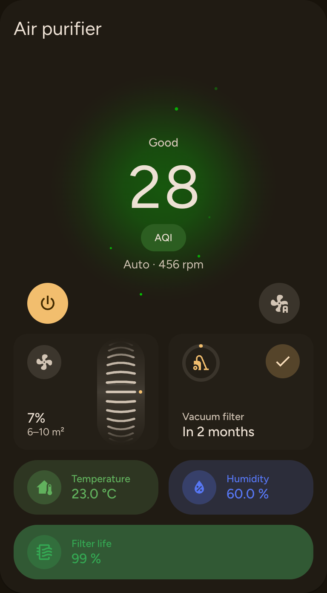
  </picture>
</p>

## Table of contents

- [Highlights](#highlights)
- [Gallery](#gallery)
- [Installation](#installation)
- [Quick start](#quick-start)
- [Card options](#card-options)
- [The dial](#the-dial)
- [Fan speed](#fan-speed)
- [Features](#features)
  - [Common feature options](#common-feature-options)
  - [Option overrides](#option-overrides)
  - [`fan-presets`](#fan-presets)
  - [`speed-wheel`](#speed-wheel)
  - [`filter-vacuum`](#filter-vacuum)
  - [`input-select`](#input-select)
  - [`switch-group`](#switch-group)
  - [`switch-list`](#switch-list)
  - [`button-list`](#button-list)
  - [`sensor-list`](#sensor-list)
  - [`entity-tile`](#entity-tile)
  - [`percentage-tile`](#percentage-tile)
- [Vacuum filter reminder](#vacuum-filter-reminder)
- [Layout & responsiveness](#layout--responsiveness)
- [Theming](#theming)
- [Development](#development)
- [Credits](#credits)
- [Tested with](#tested-with)
- [License](#license)

## Highlights

- **Air-quality dial:** value and category, with an AirNow-colored halo indicating air quality.
- Choose **US or Chinese AQI**, or **PM2.5 in µg/m³**; optionally tap the unit label to switch between index and concentration.
- Power and mode buttons, plus a status line showing mode, speed and RPM when available.
- **Speed wheel:** drag, flick, scroll or use arrow keys. Displays percentages or raw levels, with optional room-coverage estimates.
- Air-volume-based **filter vacuum reminder**, with an estimated due date from average usage since the last vacuum.
- Percentage-fill and entity tiles, sensor lists, switch lists/groups, button lists, and input-select controls.
- Ten-column layout: feature widths from **10–100%**, in steps of 10.

## Gallery

Five configurations with screenshots that follow your light or dark theme (dark by default). Copy the matching YAML below or use [showcase.yaml](examples/showcase.yaml), in the same order. Replace entity IDs with your own; Full needs **Calibrate** and **Set up tracking** in the editor (see [Vacuum filter reminder](#vacuum-filter-reminder) for the YAML alternative). Helper IDs are placeholders; use the IDs saved by your editor. Release history: [changelog](CHANGELOG.md).

### Full

<picture>
  <source media="(prefers-color-scheme: light)" srcset="assets/showcase-full-light.png">
  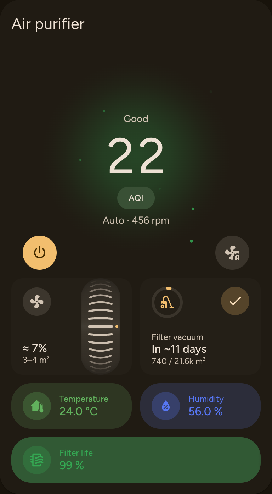
</picture>

<details>
<summary>Full configuration</summary>

```yaml
type: custom:material-purifier-card
entity: fan.zhimi_rmb1_6ab7_air_purifier
name: Air purifier
aqi: {entity: sensor.zhimi_rmb1_6ab7_pm25_density, metric: aqi, scale: us}
motor_speed_entity: sensor.zhimi_rmb1_6ab7_moto_speed_rpm
cadr: 360 # Xiaomi Air Purifier 4 Lite datasheet, m³/h.
# calibration: written by Calibrate.
features:
  - {type: speed-wheel, entity: number.zhimi_rmb1_6ab7_favorite_level, width: 50}
  # Placeholder IDs created by Set up tracking; use the IDs saved by your editor.
  - {type: filter-vacuum, width: 50, counter_entity: sensor.xiaomi_smart_air_purifier_4_lite_runtime_since_vacuum, dust_level: medium}
  - {type: entity-tile, entity: sensor.zhimi_rmb1_6ab7_temperature, name: Temperature, icon: 'mdi:home-thermometer', color: '#61b15d'}
  - {type: entity-tile, entity: sensor.zhimi_rmb1_6ab7_relative_humidity, name: Humidity, icon: 'mdi:water-percent', color: '#5777f4'}
  - {type: percentage-tile, entity: sensor.zhimi_rmb1_6ab7_filter_life_level, name: Filter life, icon: 'mdi:air-filter', width: 100, ranges: [{to: 20, color: '#ea4335'}, {from: 20, to: 50, color: '#f9ab00'}, {from: 50, color: '#34a853'}]}
```

</details>

### Minimal

Hide the title and move the dial up with `show_name: false`.

<picture>
  <source media="(prefers-color-scheme: light)" srcset="assets/showcase-minimal-light.png">
  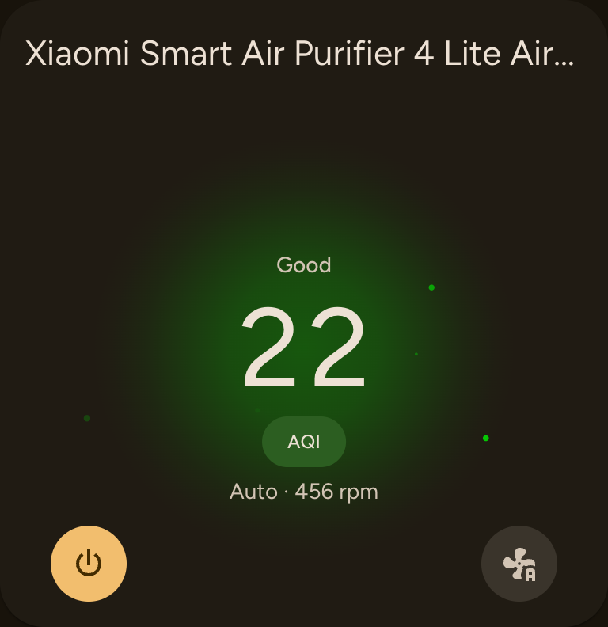
</picture>

<details>
<summary>Minimal configuration</summary>

```yaml
type: custom:material-purifier-card
entity: fan.zhimi_rmb1_6ab7_air_purifier
cadr: 360 # Xiaomi Air Purifier 4 Lite datasheet, m³/h.
# calibration: written by Calibrate.
```

</details>

### China AQI

Tap the unit label to switch between Chinese AQI and µg/m³; choose presets from a dropdown.

<picture>
  <source media="(prefers-color-scheme: light)" srcset="assets/showcase-cn-light.png">
  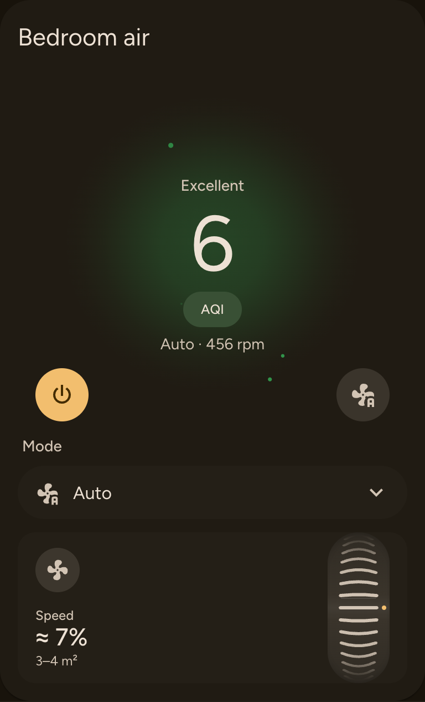
</picture>

<details>
<summary>China AQI configuration</summary>

```yaml
type: custom:material-purifier-card
entity: fan.zhimi_rmb1_6ab7_air_purifier
name: Bedroom air
aqi: {entity: sensor.zhimi_rmb1_6ab7_pm25_density, metric: aqi, scale: cn, allow_cycle: true}
motor_speed_entity: sensor.zhimi_rmb1_6ab7_moto_speed_rpm
cadr: 360 # Xiaomi Air Purifier 4 Lite datasheet, m³/h.
# calibration: written by Calibrate.
features:
  - {type: fan-presets, display: dropdown, label: Mode}
  - {type: speed-wheel, entity: number.zhimi_rmb1_6ab7_favorite_level, width: 100, label: Speed}
```

</details>

### Tiles showcase

<picture>
  <source media="(prefers-color-scheme: light)" srcset="assets/showcase-tiles-light.png">
  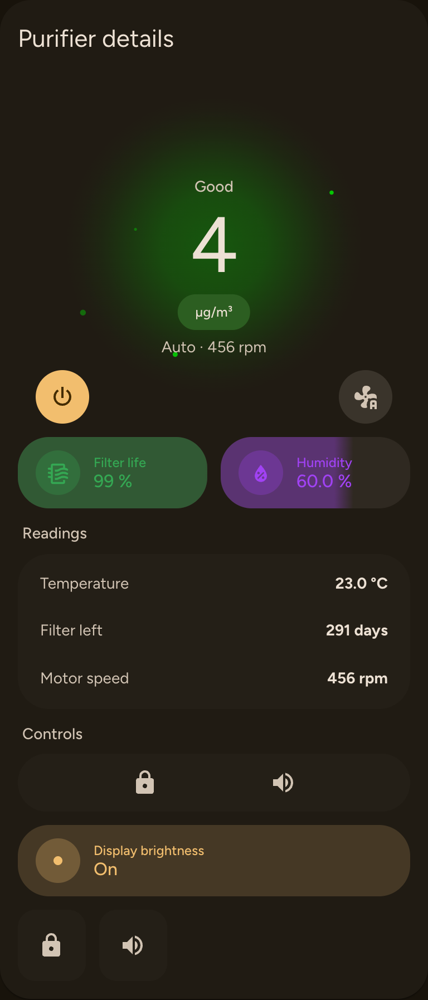
</picture>

<details>
<summary>Tiles configuration</summary>

```yaml
type: custom:material-purifier-card
entity: fan.zhimi_rmb1_6ab7_air_purifier
name: Purifier details
cadr: 360 # Xiaomi Air Purifier 4 Lite datasheet, m³/h.
# calibration: written by Calibrate.
aqi: {entity: sensor.zhimi_rmb1_6ab7_pm25_density, metric: pm25}
features:
  - {type: percentage-tile, entity: sensor.zhimi_rmb1_6ab7_filter_life_level, name: Filter life, icon: 'mdi:air-filter', width: 50, ranges: [{to: 20, color: '#ea4335'}, {from: 20, to: 50, color: '#f9ab00'}, {from: 50, color: '#34a853'}]}
  - {type: percentage-tile, entity: sensor.zhimi_rmb1_6ab7_relative_humidity, name: Humidity, icon: 'mdi:water-percent', width: 50, ranges: [{to: 30, color: '#f9ab00'}, {from: 30, to: 60, color: '#4285f4'}, {from: 60, color: '#a142f4'}]}
  - {type: sensor-list, label: Readings, items: [{entity: sensor.zhimi_rmb1_6ab7_temperature, label: Temperature}, {entity: sensor.zhimi_rmb1_6ab7_filter_left_time, label: Filter left}, {entity: sensor.zhimi_rmb1_6ab7_moto_speed_rpm, label: Motor speed}]}
  - {type: switch-list, label: Controls, entities: [{entity: switch.zhimi_rmb1_6ab7_physical_control_locked, label: Child lock, icon: 'mdi:lock'}, {entity: switch.zhimi_rmb1_6ab7_alarm, label: Sounds, icon: 'mdi:volume-high'}]}
  - {type: input-select, entity: select.zhimi_rmb1_6ab7_brightness, label: Display brightness, display: tile}
  - {type: entity-tile, entity: switch.zhimi_rmb1_6ab7_physical_control_locked, display: icon, icon: 'mdi:lock', width: 20}
  - {type: entity-tile, entity: switch.zhimi_rmb1_6ab7_alarm, display: icon, icon: 'mdi:volume-high', width: 20}
```

</details>

### Compact

<picture>
  <source media="(prefers-color-scheme: light)" srcset="assets/showcase-compact-light.png">
  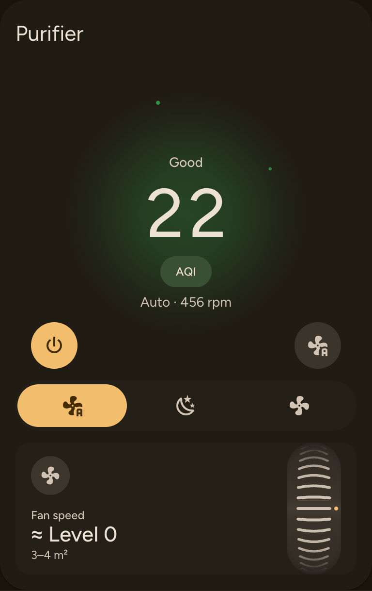
</picture>

<details>
<summary>Compact configuration</summary>

```yaml
type: custom:material-purifier-card
entity: fan.zhimi_rmb1_6ab7_air_purifier
name: Purifier
aqi: {entity: sensor.zhimi_rmb1_6ab7_pm25_density}
motor_speed_entity: sensor.zhimi_rmb1_6ab7_moto_speed_rpm
cadr: 360 # Xiaomi Air Purifier 4 Lite datasheet, m³/h.
# calibration: written by Calibrate.
features:
  - {type: fan-presets, display: icons}
  - {type: speed-wheel, entity: number.zhimi_rmb1_6ab7_favorite_level, display: level, width: 100}
```

</details>

## Installation

> Requires Home Assistant **2024.8.0** or newer.

### HACS (recommended)

[](https://my.home-assistant.io/redirect/hacs_repository/?owner=lageorgem&repository=ha-material-purifier-card&category=plugin)

1. Click the **Open in HACS** button, or in HACS go to **⋮ → Custom repositories** and add
   `https://github.com/lageorgem/ha-material-purifier-card` with category **Dashboard** (Lovelace).
2. Install **Material Purifier Card**.
3. Reload your browser (HACS adds the dashboard resource automatically).

If the resource was not registered, add `/hacsfiles/ha-material-purifier-card/material-purifier-card.js`
as a **JavaScript Module** under **Settings → Dashboards → ⋮ → Resources**.

### Manual

| Step | Action |
| --- | --- |
| 1 | Download `material-purifier-card.js` from the [latest release](https://github.com/lageorgem/ha-material-purifier-card/releases). |
| 2 | Copy it to `/config/www/`. |
| 3 | Add a dashboard resource: **Settings → Dashboards → ⋮ → Resources → Add**, URL `/local/material-purifier-card.js`, type **JavaScript Module**. Reload your browser. |

For YAML-managed resources:

```yaml
lovelace:
  resources:
    - url: /local/material-purifier-card.js
      type: module
```

## Quick start

Add **Material Purifier Card** from the dashboard's **Add card** picker and configure it visually,
or add a manual card and paste:

```yaml
type: custom:material-purifier-card
entity: fan.living_room_purifier
aqi:
  entity: sensor.living_room_pm25
  source: pm25
features:
  - type: fan-presets
  - type: speed-wheel
```

Replace entity IDs with your own. The wheel requires a fan with percentage support or an explicit `entity` on the `speed-wheel` feature; see [Fan speed](#fan-speed).
The [full example](examples/card-full.yaml) includes extra controls and a resettable vacuum counter.

## Card options

All options in the tables are optional unless marked **required**. Defaults apply when YAML keys are omitted. See the [changelog](CHANGELOG.md) for changes.

| Option | Type | Default / purpose |
| --- | --- | --- |
| `type` | string, required | `custom:material-purifier-card` |
| `entity` | string, required | Purifier `fan.*` entity |
| `name` | string | Fan friendly name, then entity ID; override with e.g. `Air purifier` |
| `show_name` | boolean | `true`; `false` hides the title row and moves the dial up. `name` still sets the card's accessible label |
| `theme` | string | Current dashboard theme; override with e.g. `Material Rounded` |
| `aqi` | object | Auto-detected PM2.5 source and US AQI display; e.g. `{metric: aqi, scale: us}`; see below |
| `speed` | object | Deprecated legacy `entity`, `preset`, `display`, `estimate_auto` settings. Still read as fallbacks; wheel fields win. The editor migrates these into the `speed-wheel` feature |
| `motor_speed_entity` | string | Motor-speed sensor in RPM; otherwise auto-detected on the fan's device. Enables live speed estimates, calibration and vacuum tracking |
| `max_rpm` | number | Optional full-speed RPM override; otherwise highest RPM in `calibration`. No built-in default |
| `cadr` | number | Full-speed clean-air delivery rate in m³/h from your datasheet; needed for air volume and room coverage. No default |
| `calibration` | list of `{value, rpm}` | Measured speed-to-RPM points; `value` is the speed entity value or fan percentage, `rpm` the measured motor speed. **Calibrate** saves the lowest and highest speed; additional measured points are allowed |
| `features` | list | `[]`; optional controls below the dial; each entry has a `type` |

## The dial

The dial shows an **air-quality value and category**: AQI on the US or China scale, or PM2.5 in **µg/m³**.
The halo color indicates the air-quality level using **AirNow colors**.
Particles get denser with worse air and are drawn in faster as the fan speeds up.
The status line shows **mode · speed · RPM**, when those readings are available.

| Interaction | Behavior |
| --- | --- |
| **Power** (bottom-left) | Turn the purifier on or off |
| **Mode** (bottom-right) | Cycle the fan's preset modes |
| **Unit label** | Toggle AQI ↔ µg/m³ only when `aqi.allow_cycle: true`; remembered per browser |

### AQI options

| Option | Type | Default / purpose |
| --- | --- | --- |
| `entity` | string | Auto-detect a PM2.5 sensor on the fan's device; set explicitly if detection is ambiguous |
| `attribute` | string | Entity state; e.g. `pm25` reads this entity attribute instead (no state fallback if missing) |
| `source` | `pm25`, `us_aqi`, `cn_aqi` | Defaults to `pm25` (including PM2.5 units/device class); set explicitly when the sensor reports US or Chinese AQI |
| `metric` | `aqi`, `pm25` (legacy: `us_aqi`, `cn_aqi`) | `aqi`; display an index or concentration. Legacy values imply `aqi` with the corresponding scale |
| `scale` | `us`, `cn` | `us`; AQI scale. An explicit scale wins over a legacy metric's implied scale |
| `allow_cycle` | boolean | `false`; tapping the label toggles AQI ↔ µg/m³ with browser-local persistence |
| `us_breakpoints` | `'2024'`, `'2012'` | `'2024'`; quote the year in YAML |

### AQI scales and sensor meaning

Use `aqi.metric: aqi` (default) for an index or `aqi.metric: pm25` for concentration. `aqi.scale: us` (default) selects US AQI; `cn` selects Chinese AQI. The dial label remains **AQI**, regardless of scale, or **µg/m³** for concentration. Legacy `metric: us_aqi` and `metric: cn_aqi` remain accepted; an explicit `scale` takes precedence over their implied scale. `allow_cycle: true` toggles only AQI ↔ µg/m³, not the scale.

Set `source` to what your sensor reports: `pm25` for concentration in µg/m³, `us_aqi` for US AQI, or `cn_aqi` for Chinese AQI. Changing the display metric does not change the sensor's meaning.

AQI uses EPA **2024** US breakpoints or HJ **633-2012** Chinese PM2.5 breakpoints:

| Index range | US 2024 PM2.5 (µg/m³) | CN PM2.5 (µg/m³) |
| --- | --- | --- |
| 0–50 | 0–9.0 | 0–35 |
| 51–100 | 9.1–35.4 | 35–75 |
| 101–150 | 35.5–55.4 | 75–115 |
| 151–200 | 55.5–125.4 | 115–150 |
| 201–300 | 125.5–225.4 | 150–250 |
| 301–400 | Part of 225.5–325.4 → 301–500 | 250–350 |
| 401–500 | Part of 225.5–325.4 → 301–500 | 350–500 |

Set `aqi.us_breakpoints: '2012'` if you need the legacy EPA scale.

These are **PM2.5-derived readings**, not a multi-pollutant AQI or a regulatory 24-hour/NowCast calculation. An instantaneous sensor remains instantaneous. Converting an already-rounded AQI back to concentration is approximate.

## Fan speed

With no `entity` on the `speed-wheel` feature, the card uses `fan.set_percentage` when supported. Otherwise, point that feature to a speed-setting `number.*` or `input_number.*`; the entity's min/max/step define the wheel range.

<p align="center">
  <picture>
    <source media="(prefers-color-scheme: light)" srcset="assets/wheel-light.png">
    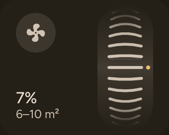
  </picture>
</p>

| Interaction | Behavior |
| --- | --- |
| **Drag / flick** | Move through speed detents, with inertia |
| **Scroll while hovered** | Adjust the selected speed |
| **Arrow keys** (when focused) | Step through speeds |

Changing speed automatically activates a Favorite/Manual preset when
available, unless the wheel's `preset` overrides or disables that behavior.

### Speed-wheel options

| Option | Type | Default / purpose |
| --- | --- | --- |
| `entity` | string | `number.*` or `input_number.*`; unset uses `fan.set_percentage` if supported. Range and step come from the entity |
| `preset` | string or `false` | Auto-detects Favorite/Favourite/Manual; a string selects the exact preset before speed changes. `false` disables switching |
| `display` | `percent`, `level` | `percent`; show the selected position as a percentage of available speed steps. `level` shows the raw value; fan-percentage controls always show percent |
| `estimate_auto` | boolean | `true`; estimate live speed in Auto/Sleep from motor RPM and calibration or learned readings. Needs an RPM sensor and speed measurements. `false` shows the preset instead |
| `show_coverage` | boolean | `true`; show CADR-based room coverage when airflow can be estimated. Needs card `cadr` and maximum RPM; `false` hides it |

### Speed display and room coverage

Speed is shown as a **percentage** by default, or as the raw setting with `display: level`. For level-based controls, the percentage represents the selected position among the available steps, not measured airflow; the lowest step can be above 0%.

Room coverage is estimated from **your purifier's CADR** (clean-air delivery rate in m³/h, from its datasheet) and measured motor speed. Add `cadr` and calibrate to enable it. Treat the displayed area as a guide: room layout, ventilation and filter condition affect results.

### Calibrate

Select a motor-speed sensor and speed control, enter datasheet CADR, then press **Calibrate** in the editor. It measures your purifier's highest and lowest speeds once and saves them for speed and coverage estimates. Allow about a minute, sometimes longer for slow sensors, and expect temporary full-speed noise.

Calibration restores the previous mode, speed and power state when finished or stopped, provided Home Assistant can reach the purifier. You can also enter measured `{value, rpm}` points in YAML. The highest calibrated RPM is used as the maximum unless you set `max_rpm`.

## Features

Add controls under `features:`. Each entry has a `type` and type-specific options.
The examples in this section are fragments to merge into your card's `features` list.

| Type | Purpose |
| --- | --- |
| `fan-presets` | Select the fan's preset mode |
| `speed-wheel` | Drag, scroll or key through fan speeds |
| `filter-vacuum` | Track processed air and confirm pre-filter cleaning |
| `input-select` | Select an option on a selection entity |
| `switch-group` | Mutually exclusive switch selection |
| `switch-list` | Independent switch toggles |
| `button-list` | Independent action buttons |
| `sensor-list` | Read-only icon, title and value rows |
| `entity-tile` | Entity tile with a tap action |
| `percentage-tile` | Numeric tile with a proportional fill |

### Common feature options

| Option | Type | Applies to | Default / purpose / example |
| --- | --- | --- | --- |
| `type` | string, required | All | One of the feature types below, e.g. `speed-wheel` |
| `width` | number | All | Percentage `10`–`100`, step `10`. Defaults to `50` for `speed-wheel`, `filter-vacuum`, `entity-tile`, `percentage-tile`; `100` for selectors/lists. Example: `50` |
| `label` | string | All except `entity-tile`, `percentage-tile` | No title for selectors/lists; `Fan speed` for speed wheel; `Vacuum filter` for reminder. Example: `Mode`. Entity and percentage tiles use `name` |
| `display` | string | `fan-presets`, `input-select`, `switch-group` | `icons` (YAML default), `dropdown`, or `tile`; the visual editor adds fan presets as `tile`. Example: `dropdown` |
| `options` | object list | `fan-presets`, `input-select` | No overrides; e.g. `[{value: Silent, label: Night}]` |
| `order` | string list | `fan-presets`, `input-select` | Natural order; e.g. `[Auto, Silent, Favorite]`. Unlisted values follow |

### Option overrides

Each entry in `options` supports:

Use the fields below to customize choices; `active` and `disabled` are managed by the card, not YAML settings.

| Option | Type | Purpose |
| --- | --- | --- |
| `value` | string, required | No default; exact underlying option, e.g. `Silent`. The synthetic Off option uses `off` |
| `label` | string | Prettified option value; override with e.g. `Night` |
| `icon` | string | Automatic preset icon for fan-presets; none for input-select (text chips when no icon). Override with e.g. `mdi:weather-night` |
| `hide` | boolean | `false`; set `true` to remove this option from the selector |
| `color` | color string | Preset color for fan-presets, theme/default color for input-select; e.g. `'#6750A4'`. Accent applies in tile display |

```yaml
features:
  - type: fan-presets
    display: tile
    label: Mode
    show_off: true
    order: [Auto, Silent, Favorite]
    options:
      - value: Silent
        label: Night
        icon: mdi:weather-night
        color: '#6750A4'
```

Use preset names exactly as reported by your fan.

#### Entity list entries

`switch-group`/`switch-list` use `entities`; `button-list`/`sensor-list` use `items`. Each is a list of objects:

| Option | Type | Purpose |
| --- | --- | --- |
| `entity` | string, required | No default; entity ID, e.g. `switch.purifier_alarm` |
| `label` | string | Entity friendly name, then entity ID; override with e.g. `Sounds` |
| `icon` | string | Switch-group uses entity icon (text chips when absent); switch-list uses entity icon then `mdi:toggle-switch-variant`; button-list uses entity icon then `mdi:gesture-tap-button`. Sensor-list shows no icon unless configured. Example: `mdi:volume-high` |
| `color` | color string | No override; e.g. `'#6750A4'`. Applied only by `switch-group` in `tile` display; ignored by `switch-list`, `button-list`, and `sensor-list` even if the editor emits it |

### `fan-presets`

Selects preset modes of the card's fan. Supports common selector options: `display`, `label`, `width`, `options`, `order`.

<p align="center">
  <picture>
    <source media="(prefers-color-scheme: light)" srcset="assets/feature-fan-presets-light.png">
    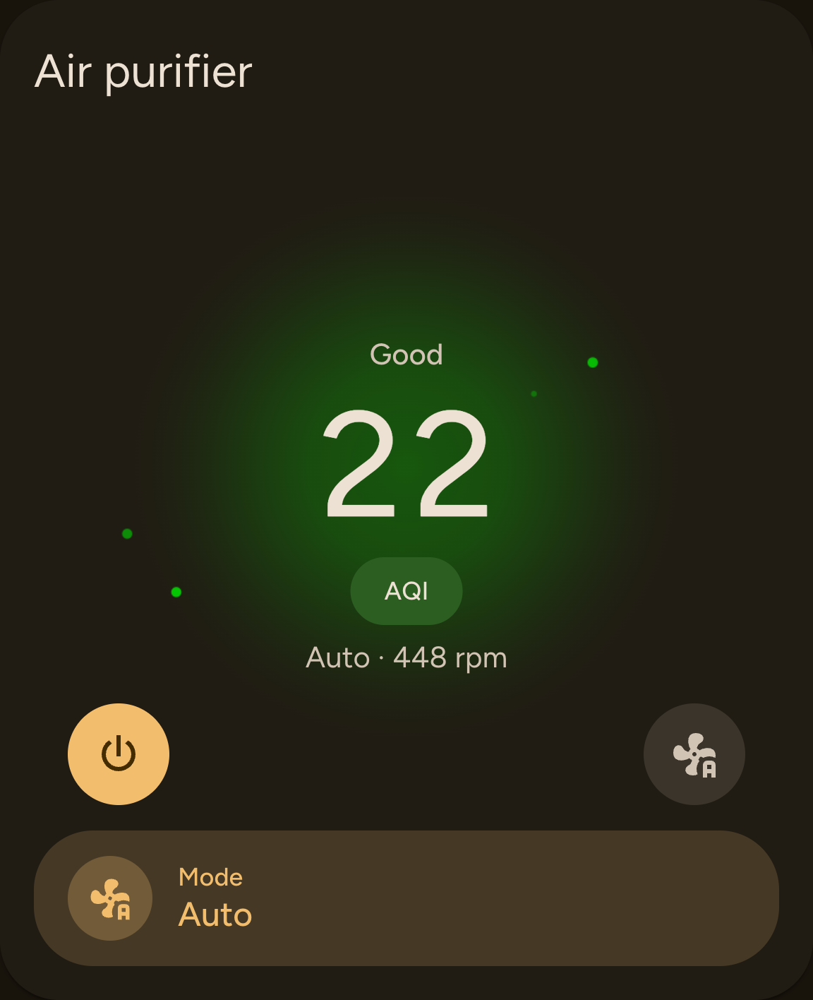
  </picture>
</p>

| Option | Type | Default / purpose |
| --- | --- | --- |
| `show_off` | boolean | `false`; prepend an Off option that turns the fan off |

```yaml
- type: fan-presets
  display: tile
  label: Mode
  show_off: true
  width: 100
```

### `speed-wheel`

Supports `label` and `width`, all [speed-wheel options](#speed-wheel-options), plus:

<p align="center">
  <picture>
    <source media="(prefers-color-scheme: light)" srcset="assets/feature-speed-wheel-light.png">
    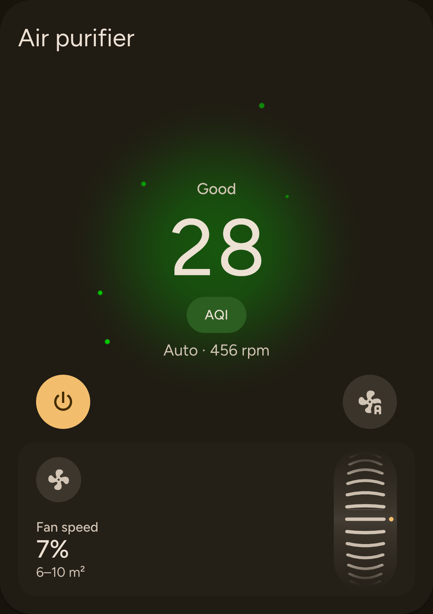
  </picture>
</p>

| Option | Type | Default / purpose |
| --- | --- | --- |
| `icon` | string | `mdi:fan` |
| `color` | color string | Theme primary; optional accent override, e.g. `'#6750A4'` |

```yaml
- type: speed-wheel
  label: Fan speed
  icon: mdi:fan
  width: 50
```

### `filter-vacuum`

Supports `label` and `width` plus:

<p align="center">
  <picture>
    <source media="(prefers-color-scheme: light)" srcset="assets/feature-filter-vacuum-light.png">
    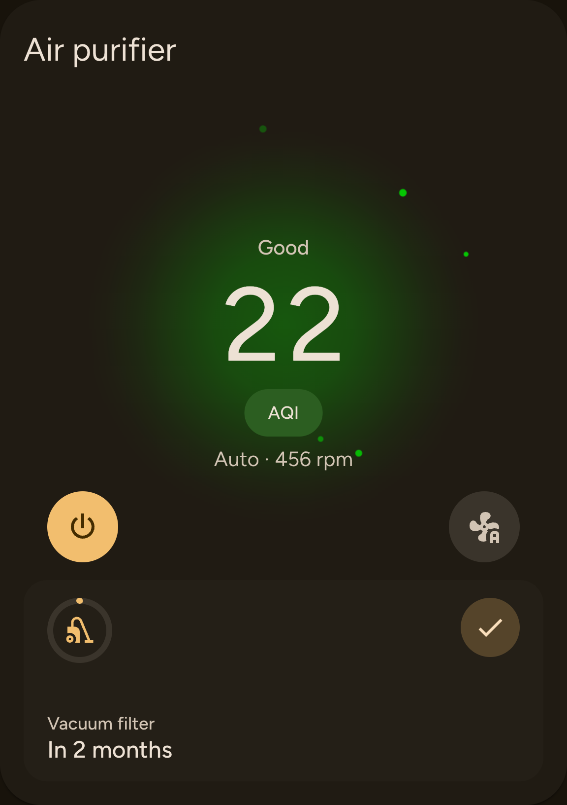
  </picture>
</p>

| Option | Type | Default / purpose |
| --- | --- | --- |
| `counter_entity` | string | Utility Meter sensor over an Integration of motor RPM, counting rpm·h since the last vacuum with no scheduled cycle; created by **Set up tracking**. Needed for tracking; **Mark vacuumed** resets it to zero |
| `dust_level` | `low`, `medium`, `high` | Threshold setting; wins over `dust_level_entity`. Defaults to `medium` when no fallback is available; neither shown nor changeable on the tile |
| `dust_level_entity` | string | Optional read-only `input_select.*` or `select.*` fallback reporting `low`, `medium`, `high`; read only when `dust_level` is unset |
| `thresholds` | object | Optional positive-number m³ overrides: `low` defaults to `250000`, `medium` to `125000`, `high` to `62500`. Each key is optional; e.g. `{low: 250000, medium: 125000, high: 62500}` |
| `icon` | string | `mdi:vacuum`; optional icon override |
| `color` | color string | Theme primary; e.g. `'#6750A4'`. A due reminder always uses theme error color |

```yaml
- type: filter-vacuum
  label: Vacuum filter
  # Placeholder counter ID created by Set up tracking; confirm your own ID.
  counter_entity: sensor.xiaomi_smart_air_purifier_4_lite_runtime_since_vacuum
  dust_level: medium
  width: 50
```

Use **Set up tracking** in this feature's editor with an administrator account. Card `cadr` and calibrated maximum RPM (or `max_rpm`) are also needed; see [Vacuum filter reminder](#vacuum-filter-reminder) for setup and the YAML alternative.

### `input-select`

Supports common selector options: `display`, `label`, `width`, `options`, `order`.

<p align="center">
  <picture>
    <source media="(prefers-color-scheme: light)" srcset="assets/feature-input-select-light.png">
    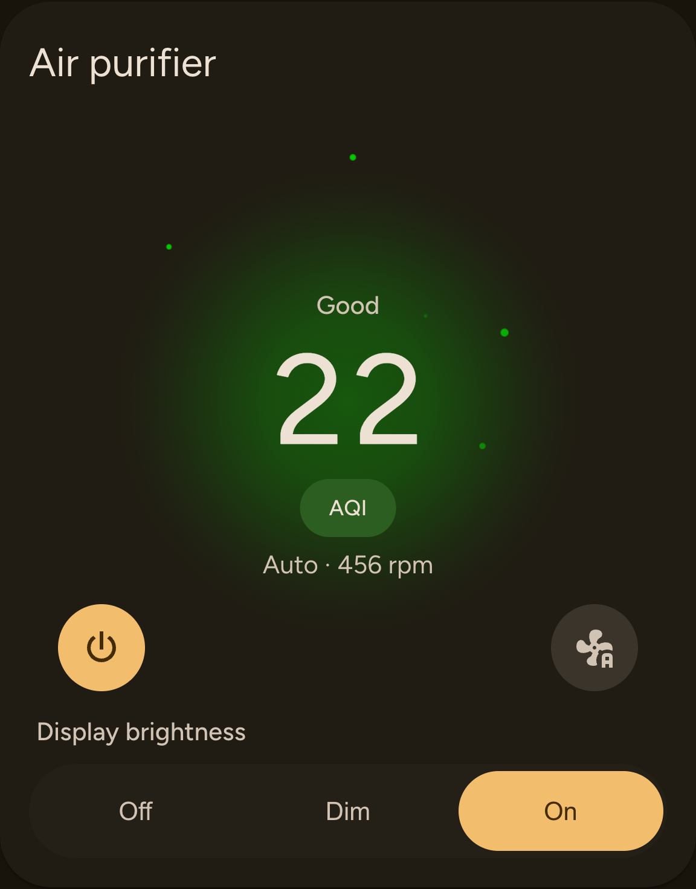
  </picture>
</p>

| Option | Type | Purpose |
| --- | --- | --- |
| `entity` | string, required | `input_select.*` or `select.*`, e.g. `input_select.purifier_dust_level` or `select.zhimi_rmb1_6ab7_brightness`. Calls the entity domain's `select_option` service; other domains produce a warning and no service call |

```yaml
- type: input-select
  entity: input_select.purifier_dust_level
  label: Household dust
  display: dropdown
  options:
    - value: high
      label: High dust
      icon: mdi:weather-dust
```

### `switch-group`

A mutually exclusive selector: choosing a switch turns the others off, then the chosen one on.
Supports `display`, `label`, `width`.

<p align="center">
  <picture>
    <source media="(prefers-color-scheme: light)" srcset="assets/feature-switch-group-light.png">
    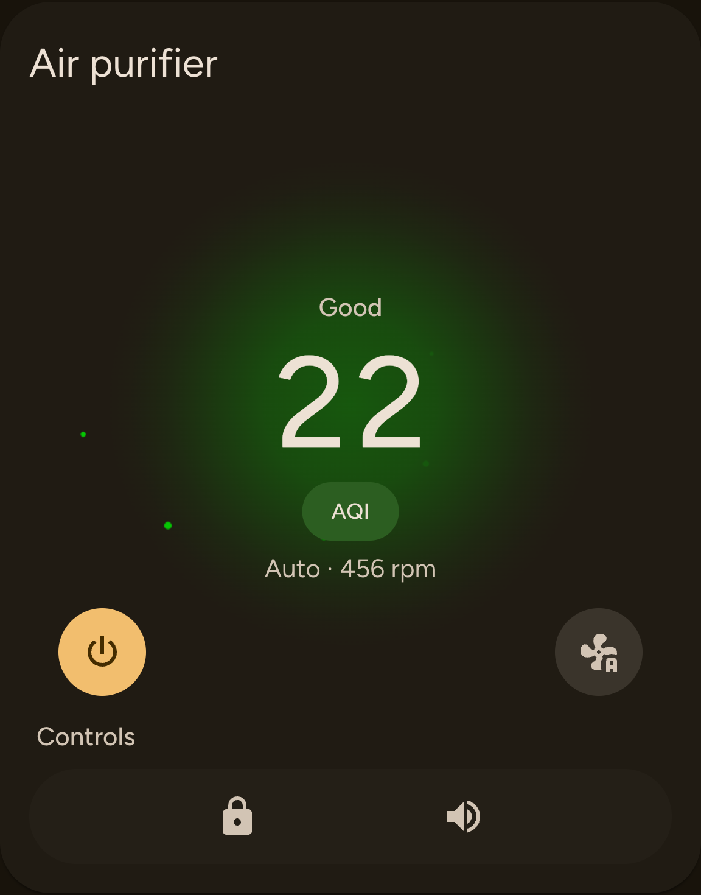
  </picture>
</p>

| Option | Type | Purpose |
| --- | --- | --- |
| `entities` | EntityItem list, required | Switch entries; see entity list entries above |

```yaml
- type: switch-group
  display: icons
  label: Lighting
  entities:
    - { entity: switch.purifier_display_bright, label: Bright, icon: mdi:brightness-7 }
    - { entity: switch.purifier_display_dim, label: Dim, icon: mdi:brightness-4 }
```

### `switch-list`

Independent switch controls. Supports `label`, `width`.

<p align="center">
  <picture>
    <source media="(prefers-color-scheme: light)" srcset="assets/feature-switch-list-light.png">
    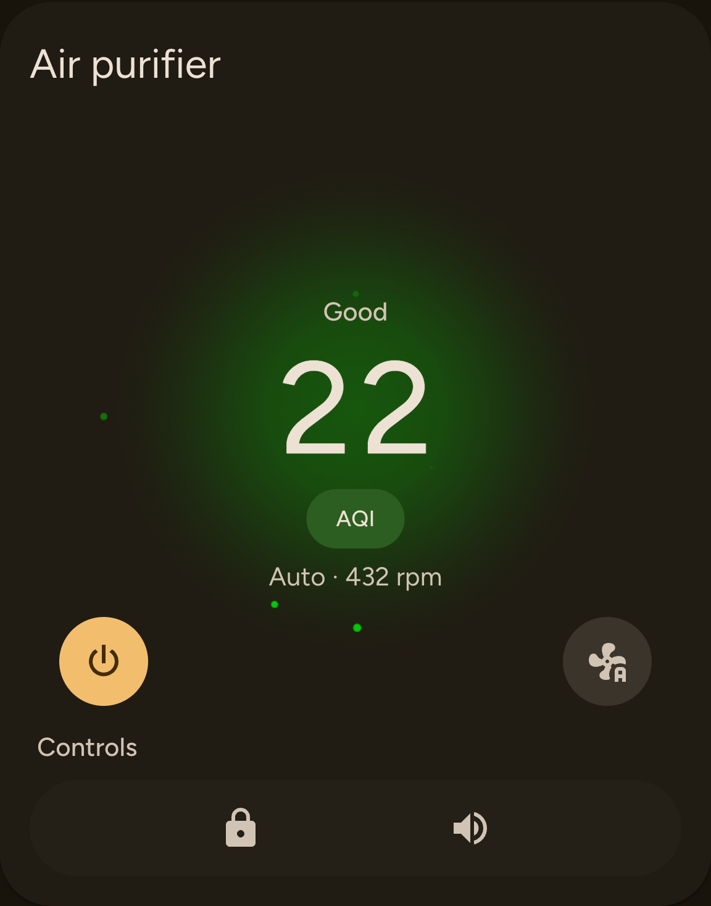
  </picture>
</p>

| Option | Type | Purpose |
| --- | --- | --- |
| `entities` | EntityItem list, required | Switch entries |

```yaml
- type: switch-list
  label: Device settings
  entities:
    - { entity: switch.purifier_child_lock, label: Child lock, icon: mdi:lock }
    - { entity: switch.purifier_alarm, label: Alarm, icon: mdi:volume-high }
```

### `button-list`

Action buttons. Supports `label`, `width`.

<p align="center">
  <picture>
    <source media="(prefers-color-scheme: light)" srcset="assets/feature-button-list-light.png">
    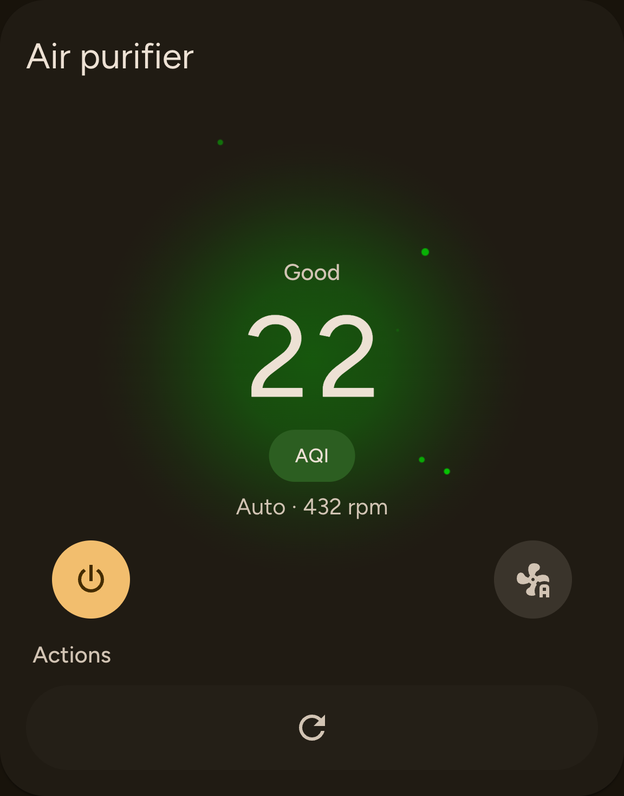
  </picture>
</p>

| Option | Type | Purpose |
| --- | --- | --- |
| `items` | EntityItem list, required | Button/action entity entries |

```yaml
- type: button-list
  items:
    - { entity: button.purifier_restart, label: Restart, icon: mdi:restart }
    - { entity: scene.quiet_evening, label: Quiet evening, icon: mdi:weather-night }
```

Uses `items`, not `entities`; buttons, scenes and scripts are pressed independently.

### `sensor-list`

Read-only sensor rows with icon, title, and current value. Supports `label`, `width`.

<p align="center">
  <picture>
    <source media="(prefers-color-scheme: light)" srcset="assets/feature-sensor-list-light.png">
    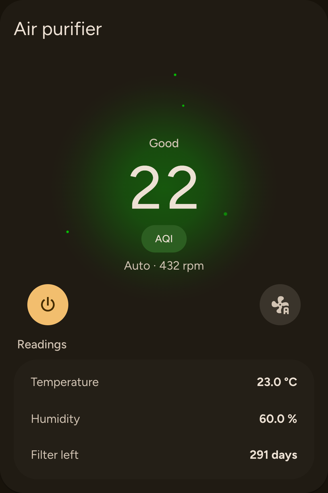
  </picture>
</p>

| Option | Type | Purpose |
| --- | --- | --- |
| `items` | EntityItem list, required | Sensor entries |

```yaml
- type: sensor-list
  label: Air
  items:
    - { entity: sensor.living_room_temperature, label: Temperature, icon: mdi:thermometer }
    - { entity: sensor.living_room_humidity, label: Humidity, icon: mdi:water-percent }
```

### `entity-tile`

<p align="center">
  <picture>
    <source media="(prefers-color-scheme: light)" srcset="assets/feature-entity-tile-light.png">
    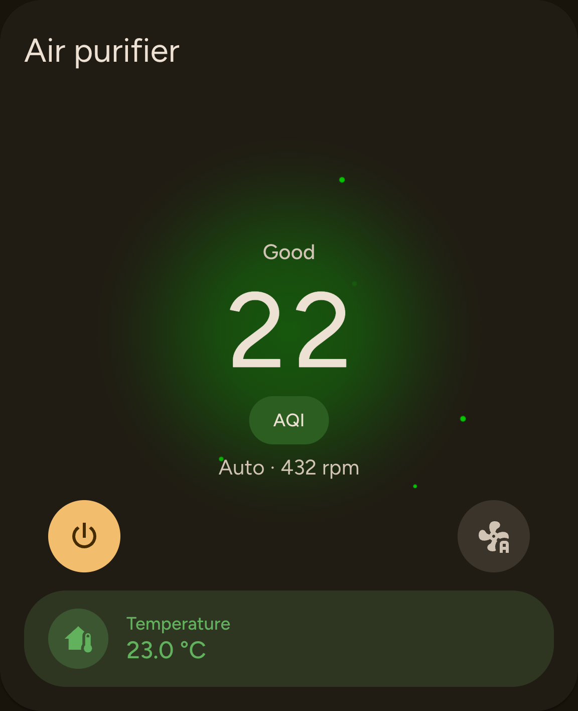
  </picture>
</p>

| Option | Type | Default / purpose |
| --- | --- | --- |
| `entity` | string, required | Entity shown by the tile |
| `name` | string | Entity friendly name, then entity ID; e.g. `Filter life` |
| `icon` | string | Entity icon, then domain icon, then `mdi:eye`; e.g. `mdi:air-filter` |
| `color` | color string | Domain/theme accent; e.g. `'#6750A4'`. Override in `tile` display |
| `display` | `icon`, `tile` | `tile`; bare icon chip or full title/value tile |
| `tap_action` | action object | Default: press buttons/input buttons, activate scenes/scripts, toggle switches/lights/fans/input booleans, otherwise more-info. Example: `{action: more-info}`; see [Tap actions](#tap-actions) |
| `width` | number | `50`; percentage `10`–`100`, step `10` |

```yaml
features:
  - type: entity-tile
    entity: sensor.purifier_filter_life
    name: Filter life
    icon: mdi:air-filter
    tap_action:
      action: more-info
  - type: input-select
    entity: input_select.purifier_dust_level
    label: Household dust
    display: dropdown
```

### `percentage-tile`

Shows a numeric state or attribute with a proportional background fill, such as remaining filter life or humidity.

<p align="center">
  <picture>
    <source media="(prefers-color-scheme: light)" srcset="assets/feature-percentage-tile-light.png">
    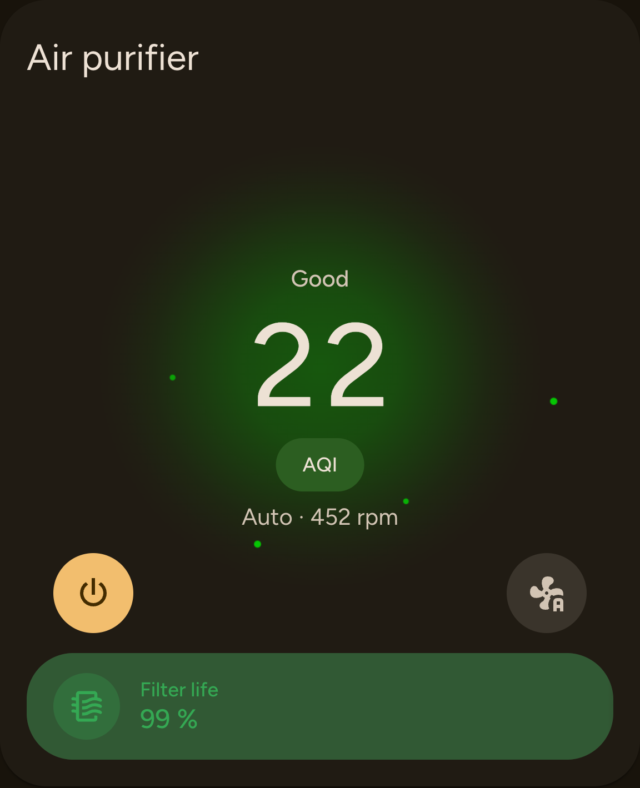
  </picture>
</p>

| Option | Type | Default / purpose |
| --- | --- | --- |
| `entity` | string, required | Entity providing the numeric value |
| `attribute` | string | Entity state; e.g. `percentage` reads that attribute (falls back to state if absent) |
| `name` | string | Entity friendly name, then entity ID; e.g. `Filter life` |
| `icon` | string | Entity icon, then `mdi:gauge`; e.g. `mdi:air-filter` |
| `color` | color string | Theme primary; fill color when no range matches, e.g. `'#4285f4'` |
| `min` | number | `0`; value mapped to an empty tile, e.g. `0` |
| `max` | number | `100`; value mapped to a full tile, e.g. `100` |
| `ranges` | list of range objects | Optional fill colors evaluated against the raw value, not the mapped percentage; first matching range wins |
| `tap_action` | action object | `{action: more-info}`; see [Tap actions](#tap-actions) |
| `width` | number | `50`; percentage `10`–`100`, step `10` |

Each range supports:

| Option | Type | Purpose |
| --- | --- | --- |
| `from` | number | Inclusive lower bound; omit for no lower bound. Example: `20` |
| `to` | number | Exclusive upper bound; the last range includes its `to`. Omit for no upper bound. Example: `50` |
| `color` | color string, required | No default; fill color for this range, e.g. `'#34a853'` |

Order ranges deliberately: overlapping ranges use the first match. This filter-life example is red below 20, amber from 20 to below 50, and green from 50 upward:

```yaml
features:
  - type: percentage-tile
    entity: sensor.zhimi_rmb1_6ab7_filter_life_level
    name: Filter life
    icon: mdi:air-filter
    ranges:
      - to: 20
        color: '#B3261E'
      - from: 20
        to: 50
        color: '#FFB300'
      - from: 50
        color: '#2E7D32'
    width: 50
```

### Tap actions

`entity-tile` and `percentage-tile` support the following fields inside `tap_action`. Only `action` is required for an explicit action. Other standard Home Assistant fields (such as confirmation, hold actions, or navigation replacement) are not implemented by this card.

| Option | Type / required | Default / purpose / example |
| --- | --- | --- |
| `action` | string, required | `none`, `more-info`, `toggle`, `url`, `navigate`, `call-service`, or `perform-action`. Example: `more-info`. Omitted action objects use each tile's default above; unrecognized actions fall back to entity press/toggle/more-info |
| `entity` | string, optional | Tile entity; override for `more-info`, e.g. `fan.zhimi_rmb1_6ab7_air_purifier` |
| `url_path` | string, required for `url` | No default; e.g. `https://www.home-assistant.io/`. Opens a new browser context |
| `navigation_path` | string, required for `navigate` | No default; e.g. `/lovelace/air`. Pushes a browser history entry |
| `perform_action` | string, required for service actions unless `service` is set | No default; e.g. `fan.turn_on`. Takes precedence over `service` |
| `service` | string, optional alias | No default; e.g. `fan.turn_on` for `call-service` |
| `data` | object, optional | `{}`; service data, e.g. `{percentage: 50}`. Takes precedence over `service_data` |
| `service_data` | object, optional alias | `{}`; e.g. `{percentage: 50}` |
| `target` | object, optional | No target; Home Assistant service target, e.g. `{entity_id: fan.zhimi_rmb1_6ab7_air_purifier}`. Does not implicitly target the tile entity |

```yaml
features:
  - type: entity-tile
    entity: fan.zhimi_rmb1_6ab7_air_purifier
    tap_action:
      action: perform-action
      perform_action: fan.set_percentage
      data: {percentage: 50}
      target: {entity_id: fan.zhimi_rmb1_6ab7_air_purifier}
```

## Vacuum filter reminder

Dust and hair collect on the **pre-filter**; clean it following your purifier manufacturer's instructions.

The **Vacuum filter** tile (YAML type `filter-vacuum`) tracks **estimated air processed**, not elapsed calendar days or measured filter dirt. It is a heuristic for vacuuming the pre-filter; tune thresholds to your home. It does not replace filter-life tracking.

The tile shows an estimated cleaning date. Tap its body for air-volume details. After cleaning, open the checkmark confirmation and choose **Mark vacuumed** to reset tracking. Cancel with the cross or Escape.

<p align="center">
  <picture>
    <source media="(prefers-color-scheme: light)" srcset="assets/vacuum-confirm-light.png">
    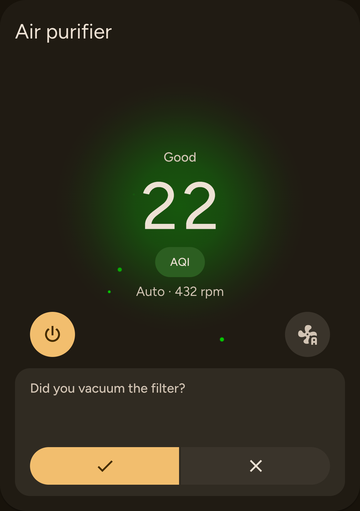
  </picture>
</p>

To enable tracking, select your motor-speed sensor, enter datasheet **CADR**, and run **Calibrate** (or provide `max_rpm`). Then press **Set up tracking** in the filter-vacuum feature editor with an administrator account. It creates the two tracking helpers and saves `counter_entity` for you.

| Dust level | Default threshold |
| --- | --- |
| low | 250,000 m³ |
| medium | 125,000 m³ |
| high | 62,500 m³ |

These are starting points, not fixed cleaning intervals; tune them to your home's dust and usage.

Set feature `dust_level`, or omit it to read `dust_level_entity` (`input_select.*` / `select.*`) as a read-only fallback. An explicit setting wins; otherwise the default is medium. Each `thresholds` key can override its corresponding m³ threshold.

The due date is estimated from average usage since the last cleaning, with recorded history as a fallback; **No estimate yet** means more usage data is needed. Keep the counter in Home Assistant's recorder to allow that fallback.

For reliable tracking, check that motor RPM drops to zero when the purifier is off. If you replace a tracking helper, clean the pre-filter and use **Mark vacuumed** to start a new count.

<details>
<summary>Prefer YAML for the tracking helpers?</summary>

Use [purifier-vacuum-package.yaml](examples/purifier-vacuum-package.yaml) instead of **Set up tracking**, following the instructions in the file. It supplies an Integration helper that accumulates motor-speed readings and a resettable Utility Meter that counts usage since the last cleaning.

</details>

## Layout & responsiveness

Narrow cards stack the dial above the tiles. Wide cards can place the tiles in a column next to
the dial. The same configuration works in **Masonry** and **Sections** views, using the card's actual width.

Feature widths are percentages of the **tile area**, not the whole card in wide layout.
The tile area uses a **ten-column grid**; set `width` from **10–100%**, in steps of 10.

<p align="center">
  <picture>
    <source media="(prefers-color-scheme: light)" srcset="assets/wide-light.png">
    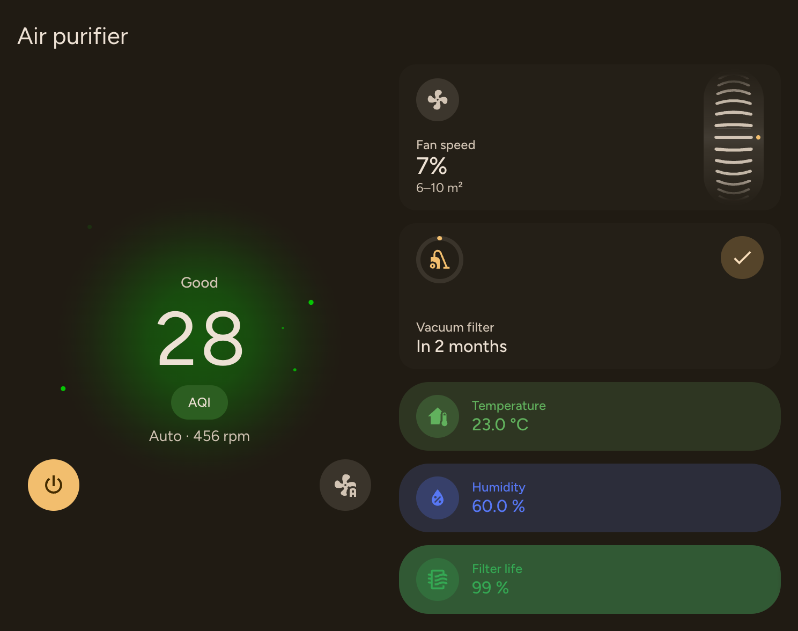
  </picture>
</p>

| Concept | Behavior |
| --- | --- |
| **Defaults** | `speed-wheel`, `filter-vacuum`, `entity-tile`, and `percentage-tile` use `50`; selectors and lists use `100`. |
| **Fill and wrap** | Two `width: 50` features share a row. A feature that does not fit wraps to the next row. |
| **Narrow stays narrow** | `width: 30` does not stretch to fill unused row space. |
| **Wide layout** | When the card is wide enough, all features are below `100%`, and there is room for the dial, features sit to its right. Otherwise the dial stacks above them. |

Use explicit widths below `100` to allow side-by-side layout; a full-width feature keeps the card stacked.

## Theming

For the intended look, use [Nerwyn's `material-you-theme`](https://github.com/Nerwyn/material-you-theme)
or another **Material You** theme built with `material-you-utilities`, such as **Material Rounded**.
The card reads `--md-sys-color-*` tokens, with Home Assistant color fallbacks when those tokens are absent.
It supports light and dark themes; `theme` can select a Home Assistant theme per card.
Per-option and tile `color` overrides accept quoted hex strings.

## Development

Requires **Node.js 22+**.

| Command | Description |
| --- | --- |
| `npm install` | Install dependencies |
| `npm run build` | Bundle to `dist/material-purifier-card.js` |
| `npm run watch` | Rebuild on change |
| `npm run typecheck` | TypeScript checking (`tsc --noEmit`) |
| `npm run lint` / `npm run lint:fix` | ESLint checking / fixes |
| `npm run format` | Format TypeScript source with Prettier |
| `npm test` | Browser-based unit/component tests with coverage |
| `npm run test:watch` | Watch-mode tests |
| `npm run deploy` | Build and upload to a local Home Assistant instance |

### Testing

Tests in `test/unit/` use `@web/test-runner`, `@open-wc/testing`, and Playwright's Chromium launcher.
Locally they run in **system Chrome**; CI uses bundled Chromium. Browser tests exercise real web
components and their DOM interactions. Coverage thresholds are **90% statements, functions and lines**,
and **85% branches**.

### Local deployment

`npm run deploy` uploads the built card through the **Home Assistant Downloader integration** from your LAN. Enable Downloader, make Home Assistant reachable, and provide `HA_URL` and `HA_TOKEN` through environment variables or `~/.config/ha-material-purifier/env`. Keep that file private. **Never commit tokens**, paste them into examples, or put them in dashboard YAML.

The private env file uses `KEY=value` lines for `HA_URL` (an HTTP(S) origin such as
`http://homeassistant.local:8123`) and `HA_TOKEN` (your long-lived access token).
The deploy script serves the bundle temporarily on your LAN, downloads it into
`/config/www/material-purifier-card/`, verifies its SHA-256, and registers or updates
`/local/material-purifier-card/material-purifier-card.js`. Home Assistant must be able to reach
your development machine. Set `LAN_HOST` if automatic LAN address detection fails;
`DEPLOY_PORT` defaults to `8799`. Reload the dashboard after deployment.

## Credits

Inspired by [purifier-card by Denys Dovhan](https://github.com/denysdovhan/purifier-card),
released under MIT. Built to pair with [Material Thermostat Card](https://github.com/lageorgem/ha-material-thermostat-card).

## Tested with

Developed and tested with a Xiaomi Smart Air Purifier 4 Lite using the Xiaomi Miot Auto integration (local), with motor speed exposed as a sensor. Other purifiers that expose a fan entity, a PM2.5 sensor and ideally a motor-speed sensor should work.

## License

[MIT](LICENSE). Release history: [CHANGELOG.md](CHANGELOG.md).
