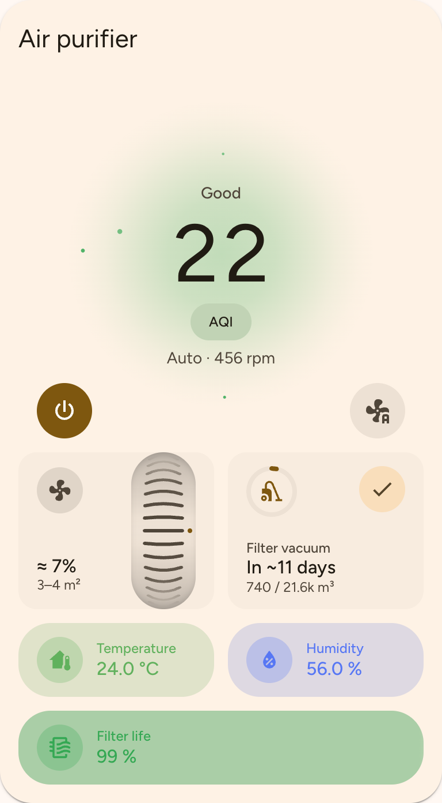
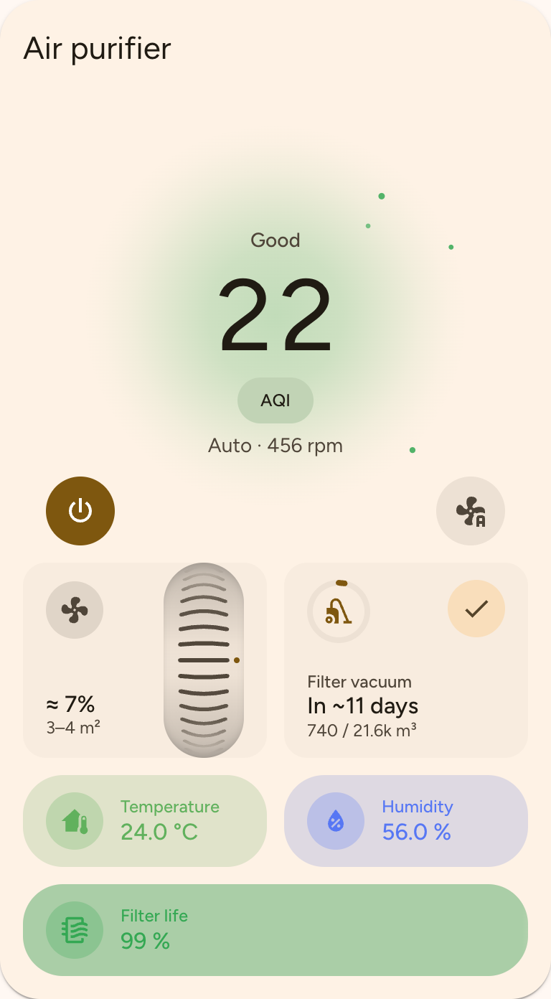
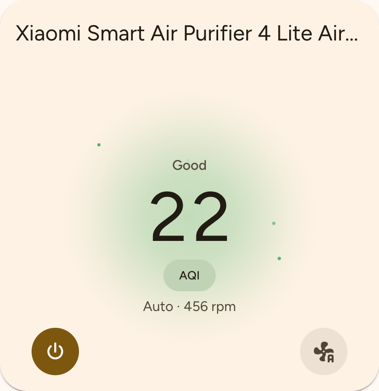
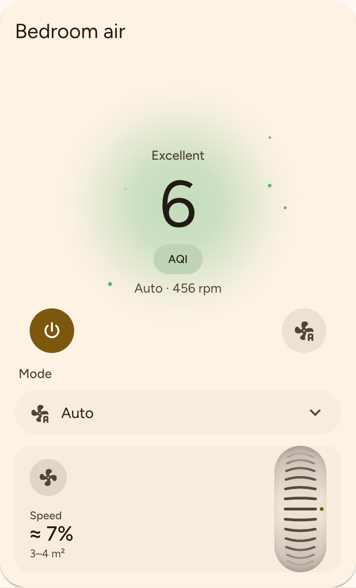
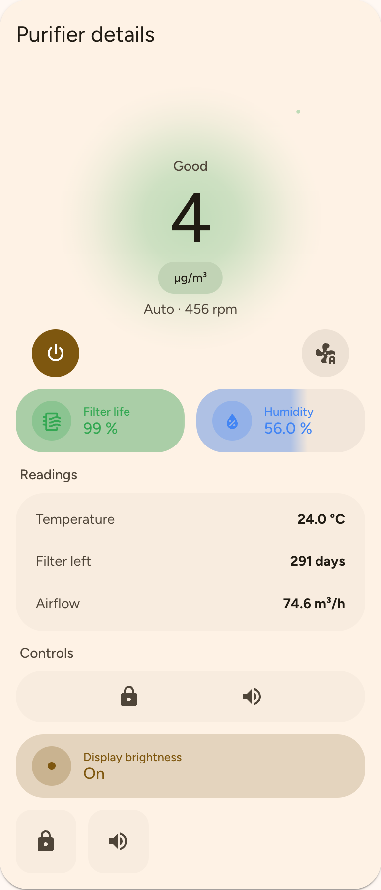
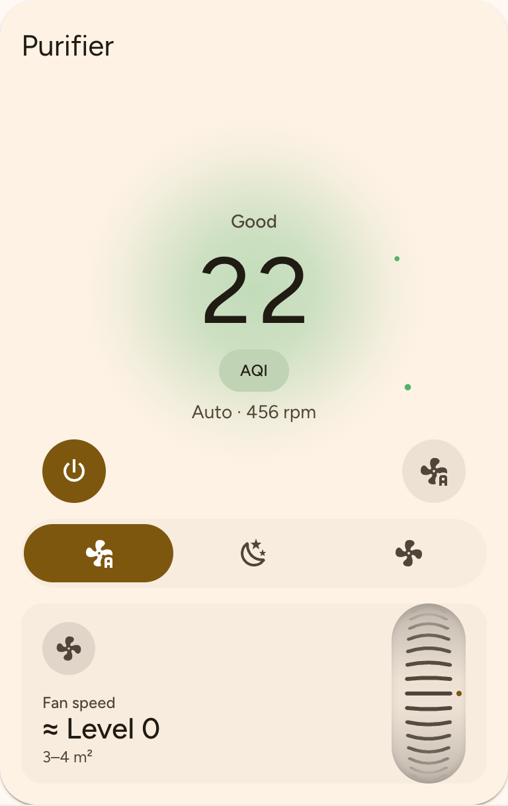
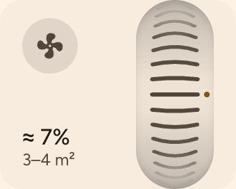
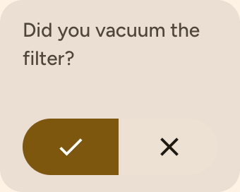

# Material Purifier Card

A [Home Assistant](https://www.home-assistant.io/) Lovelace **air purifier card** built for
**Material 3 Expressive** — a Xiaomi-app-style AQI halo with particles drawn in by the fan,
a scroll-wheel fan-speed knob with percentage and room coverage, and configurable tiles including
a filter-vacuum reminder and percentage-fill tiles. Designed to pair with
[Material Thermostat Card](https://github.com/lageorgem/ha-material-thermostat-card) and
[Nerwyn's `material-you-theme`](https://github.com/Nerwyn/material-you-theme), with graceful
Home Assistant theme fallbacks.

[](https://github.com/hacs/integration)
[](https://github.com/lageorgem/ha-material-purifier-card/releases)
[](https://github.com/lageorgem/ha-material-purifier-card/releases)
[](https://github.com/lageorgem/ha-material-purifier-card/actions/workflows/validate.yml)
[](https://github.com/lageorgem/ha-material-purifier-card/actions/workflows/test.yml)
[](https://codecov.io/gh/lageorgem/ha-material-purifier-card)
[](LICENSE)

[](https://my.home-assistant.io/redirect/hacs_repository/?owner=lageorgem&repository=ha-material-purifier-card&category=plugin)

<p align="center">
  
  
</p>

## Table of contents

- [Highlights](#highlights)
- [Gallery](#gallery)
- [Installation](#installation)
- [Quick start](#quick-start)
- [Card options](#card-options)
- [The dial](#the-dial)
- [Fan speed](#fan-speed)
- [Features](#features)
  - [Common feature options](#common-feature-options)
  - [Option overrides](#option-overrides)
  - [`fan-presets`](#fan-presets)
  - [`speed-wheel`](#speed-wheel)
  - [`filter-vacuum`](#filter-vacuum)
  - [`input-select`](#input-select)
  - [`switch-group`](#switch-group)
  - [`switch-list`](#switch-list)
  - [`button-list`](#button-list)
  - [`sensor-list`](#sensor-list)
  - [`entity-tile`](#entity-tile)
  - [`percentage-tile`](#percentage-tile)
- [Vacuum filter reminder](#vacuum-filter-reminder)
- [Layout & responsiveness](#layout--responsiveness)
- [Theming](#theming)
- [Visual editor](#visual-editor)
- [Development](#development)
- [Credits](#credits)
- [License](#license)

## Highlights

- **Xiaomi-app-style AQI dial:** a translucent air-quality-colored halo gradient, not a solid disc. Matching particles spawn at the outer edge and fade gradually toward the center. More pollution produces more particles; higher fan speed increases suction. Pauses off-screen; reduced motion shows a static field.
- Choose **AQI or µg/m³** with `aqi.metric`; `aqi.scale` selects US or Chinese AQI. The dial label is just **AQI** or **µg/m³**. Opt into label-tap cycling with `aqi.allow_cycle: true`; cycled selections are remembered per browser.
- Always-centered air-quality value, bottom-left power button, and bottom-right mode button that cycles the fan's preset modes; optional preset selectors below.
- **Speed wheel:** drag or flick with inertia, scroll while hovered, or use arrow keys. Debounced updates; automatically switches to Favorite/Manual when available. Displays percentages or raw levels, with optional room-coverage labels.
- Air-volume-based **filter vacuum reminder**, with an estimated due date from average usage since the last vacuum.
- Percentage-fill and entity tiles, sensor lists, switch lists/groups, button lists, and input-select controls.
- Ten-column layout: feature widths from **10–100%**, in steps of 10.

## Gallery

Five configurations in light and dark. Copy the matching YAML below or use [showcase.yaml](examples/showcase.yaml), in the same order. Replace entity IDs with your own; Full needs **Calibrate** and **Set up tracking** in the editor (or the [manual vacuum package](#install-the-home-assistant-package)). Helper IDs are placeholders; use the IDs saved by your editor. Release history: [changelog](CHANGELOG.md).

### Full

| Light | Dark |
| --- | --- |
|  |  |

<details>
<summary>Full configuration</summary>

```yaml
type: custom:material-purifier-card
entity: fan.zhimi_rmb1_6ab7_air_purifier
name: Air purifier
aqi: {entity: sensor.zhimi_rmb1_6ab7_pm25_density, metric: aqi, scale: us}
motor_speed_entity: sensor.zhimi_rmb1_6ab7_moto_speed_rpm
cadr: 360 # Xiaomi Air Purifier 4 Lite datasheet, m³/h.
# calibration: written by Calibrate.
features:
  - {type: speed-wheel, entity: number.zhimi_rmb1_6ab7_favorite_level, width: 50}
  # Placeholder IDs created by Set up tracking; use the IDs saved by your editor.
  - {type: filter-vacuum, width: 50, counter_entity: sensor.xiaomi_smart_air_purifier_4_lite_runtime_since_vacuum, dust_level: medium}
  - {type: entity-tile, entity: sensor.zhimi_rmb1_6ab7_temperature, name: Temperature, icon: 'mdi:home-thermometer', color: '#61b15d'}
  - {type: entity-tile, entity: sensor.zhimi_rmb1_6ab7_relative_humidity, name: Humidity, icon: 'mdi:water-percent', color: '#5777f4'}
  - {type: percentage-tile, entity: sensor.zhimi_rmb1_6ab7_filter_life_level, name: Filter life, icon: 'mdi:air-filter', width: 100, ranges: [{to: 20, color: '#ea4335'}, {from: 20, to: 50, color: '#f9ab00'}, {from: 50, color: '#34a853'}]}
```

</details>

### Minimal

Hide the title and move the dial up with `show_name: false`.

| Light | Dark |
| --- | --- |
|  |  |

<details>
<summary>Minimal configuration</summary>

```yaml
type: custom:material-purifier-card
entity: fan.zhimi_rmb1_6ab7_air_purifier
cadr: 360 # Xiaomi Air Purifier 4 Lite datasheet, m³/h.
# calibration: written by Calibrate.
```

</details>

### China AQI

Tap the unit label to switch between Chinese AQI and µg/m³; choose presets from a dropdown.

| Light | Dark |
| --- | --- |
|  |  |

<details>
<summary>China AQI configuration</summary>

```yaml
type: custom:material-purifier-card
entity: fan.zhimi_rmb1_6ab7_air_purifier
name: Bedroom air
aqi: {entity: sensor.zhimi_rmb1_6ab7_pm25_density, metric: aqi, scale: cn, allow_cycle: true}
motor_speed_entity: sensor.zhimi_rmb1_6ab7_moto_speed_rpm
cadr: 360 # Xiaomi Air Purifier 4 Lite datasheet, m³/h.
# calibration: written by Calibrate.
features:
  - {type: fan-presets, display: dropdown, label: Mode}
  - {type: speed-wheel, entity: number.zhimi_rmb1_6ab7_favorite_level, width: 100, label: Speed}
```

</details>

### Tiles showcase

| Light | Dark |
| --- | --- |
|  |  |

<details>
<summary>Tiles configuration</summary>

```yaml
type: custom:material-purifier-card
entity: fan.zhimi_rmb1_6ab7_air_purifier
name: Purifier details
cadr: 360 # Xiaomi Air Purifier 4 Lite datasheet, m³/h.
# calibration: written by Calibrate.
aqi: {entity: sensor.zhimi_rmb1_6ab7_pm25_density, metric: pm25}
features:
  - {type: percentage-tile, entity: sensor.zhimi_rmb1_6ab7_filter_life_level, name: Filter life, icon: 'mdi:air-filter', width: 50, ranges: [{to: 20, color: '#ea4335'}, {from: 20, to: 50, color: '#f9ab00'}, {from: 50, color: '#34a853'}]}
  - {type: percentage-tile, entity: sensor.zhimi_rmb1_6ab7_relative_humidity, name: Humidity, icon: 'mdi:water-percent', width: 50, ranges: [{to: 30, color: '#f9ab00'}, {from: 30, to: 60, color: '#4285f4'}, {from: 60, color: '#a142f4'}]}
  - {type: sensor-list, label: Readings, items: [{entity: sensor.zhimi_rmb1_6ab7_temperature, label: Temperature}, {entity: sensor.zhimi_rmb1_6ab7_filter_left_time, label: Filter left}, {entity: sensor.zhimi_rmb1_6ab7_moto_speed_rpm, label: Motor speed}]}
  - {type: switch-list, label: Controls, entities: [{entity: switch.zhimi_rmb1_6ab7_physical_control_locked, label: Child lock, icon: 'mdi:lock'}, {entity: switch.zhimi_rmb1_6ab7_alarm, label: Sounds, icon: 'mdi:volume-high'}]}
  - {type: input-select, entity: select.zhimi_rmb1_6ab7_brightness, label: Display brightness, display: tile}
  - {type: entity-tile, entity: switch.zhimi_rmb1_6ab7_physical_control_locked, display: icon, icon: 'mdi:lock', width: 20}
  - {type: entity-tile, entity: switch.zhimi_rmb1_6ab7_alarm, display: icon, icon: 'mdi:volume-high', width: 20}
```

</details>

### Compact

| Light | Dark |
| --- | --- |
|  |  |

<details>
<summary>Compact configuration</summary>

```yaml
type: custom:material-purifier-card
entity: fan.zhimi_rmb1_6ab7_air_purifier
name: Purifier
aqi: {entity: sensor.zhimi_rmb1_6ab7_pm25_density}
motor_speed_entity: sensor.zhimi_rmb1_6ab7_moto_speed_rpm
cadr: 360 # Xiaomi Air Purifier 4 Lite datasheet, m³/h.
# calibration: written by Calibrate.
features:
  - {type: fan-presets, display: icons}
  - {type: speed-wheel, entity: number.zhimi_rmb1_6ab7_favorite_level, display: level, width: 100}
```

</details>

## Installation

> Requires Home Assistant **2024.8.0** or newer.

### HACS (recommended)

1. Click the **Open in HACS** button above, or in HACS go to **⋮ → Custom repositories** and add
   `https://github.com/lageorgem/ha-material-purifier-card` with category **Dashboard** (Lovelace).
2. Install **Material Purifier Card**.
3. Reload your browser (HACS adds the dashboard resource automatically).

If the resource was not registered, add `/hacsfiles/ha-material-purifier-card/material-purifier-card.js`
as a **JavaScript Module** under **Settings → Dashboards → ⋮ → Resources**.

### Manual

| Step | Action |
| --- | --- |
| 1 | Download `material-purifier-card.js` from the [latest release](https://github.com/lageorgem/ha-material-purifier-card/releases). |
| 2 | Copy it to `/config/www/`. |
| 3 | Add a dashboard resource: **Settings → Dashboards → ⋮ → Resources → Add**, URL `/local/material-purifier-card.js`, type **JavaScript Module**. Reload your browser. |

For YAML-managed resources:

```yaml
lovelace:
  resources:
    - url: /local/material-purifier-card.js
      type: module
```

## Quick start

Add **Material Purifier Card** from the dashboard's **Add card** picker and configure it visually,
or add a manual card and paste:

```yaml
type: custom:material-purifier-card
entity: fan.living_room_purifier
aqi:
  entity: sensor.living_room_pm25
  source: pm25
features:
  - type: fan-presets
  - type: speed-wheel
```

Replace entity IDs with your own. The wheel requires a fan with percentage support or an explicit `entity` on the `speed-wheel` feature; see [Fan speed](#fan-speed).
The [full example](examples/card-full.yaml) includes Xiaomi 4 Lite controls and a resettable vacuum counter.

## Card options

All options in the tables are optional unless marked **required**. Defaults describe omitted YAML keys, not values explicitly inserted by the visual editor. See the [configuration audit](info.md#configuration-audit) for source references and [changelog](CHANGELOG.md) for changes.

| Option | Type | Default / purpose |
| --- | --- | --- |
| `type` | string, required | `custom:material-purifier-card` |
| `entity` | string, required | Purifier `fan.*` entity |
| `name` | string | Fan friendly name, then entity ID; override with e.g. `Air purifier` |
| `show_name` | boolean | `true`; `false` hides the title row and moves the dial up. `name` still sets the card's accessible label |
| `theme` | string | Current dashboard theme; override with e.g. `Material Rounded` |
| `aqi` | object | Auto-detected PM2.5 source and US AQI display; e.g. `{metric: aqi, scale: us}`; see below |
| `speed` | object | Deprecated legacy `entity`, `preset`, `display`, `estimate_auto` settings. Still read as fallbacks; wheel fields win. The editor migrates these into the `speed-wheel` feature |
| `motor_speed_entity` | string | RPM sensor; otherwise auto-detected on the fan's device. Used for animation, calibration and tracking setup |
| `max_rpm` | number | Optional full-speed RPM override; otherwise highest RPM in `calibration`. No built-in default |
| `cadr` | number | Full-speed clean-air delivery rate in m³/h from your datasheet; needed for air volume and room coverage. No default |
| `calibration` | list of `{value, rpm}` | Measured speed-to-RPM points; `value` is the speed entity value or fan percentage, `rpm` the measured motor speed. **Calibrate** writes two points by default; additional points are allowed and interpolated piecewise-linearly |
| `features` | list | `[]`; optional controls below the dial; each entry has a `type` |

## The dial

The **translucent halo** and particles share the current air-quality color; there is no solid disc.
Particles spawn at the outer edge at `min(30, 0.5 + 0.4 × PM2.5)` particles/second (PM2.5 in µg/m³),
then fade gradually as they are drawn toward the center. More pollution means more particles;
higher fan speed increases suction, using motor RPM when available. With the fan off, particles
drift calmly. Animation pauses off-screen; `prefers-reduced-motion` shows a static particle field.
The air-quality value always stays centered.

| Interaction | Behavior |
| --- | --- |
| **Power** (bottom-left) | Turn the purifier on or off |
| **Mode** (bottom-right) | Cycle the fan's preset modes |
| **Unit label** | Toggle AQI ↔ µg/m³ only when `aqi.allow_cycle: true`; remembered per browser |

### AQI options

| Option | Type | Default / purpose |
| --- | --- | --- |
| `entity` | string | Auto-detect a PM2.5 sensor on the fan's device; set explicitly if detection is ambiguous |
| `attribute` | string | Entity state; e.g. `pm25` reads this entity attribute instead (no state fallback if missing) |
| `source` | `pm25`, `us_aqi`, `cn_aqi` | Defaults to `pm25` (including PM2.5 units/device class); set explicitly when the sensor reports US or Chinese AQI |
| `metric` | `aqi`, `pm25` (legacy: `us_aqi`, `cn_aqi`) | `aqi`; display an index or concentration. Legacy values imply `aqi` with the corresponding scale |
| `scale` | `us`, `cn` | `us`; AQI scale. An explicit scale wins over a legacy metric's implied scale |
| `allow_cycle` | boolean | `false`; tapping the label toggles AQI ↔ µg/m³ with browser-local persistence |
| `us_breakpoints` | `'2024'`, `'2012'` | `'2024'`; quote the year in YAML |

### AQI scales and sensor meaning

Use `aqi.metric: aqi` (default) for an index or `aqi.metric: pm25` for concentration. `aqi.scale: us` (default) selects US AQI; `cn` selects Chinese AQI. The dial label remains **AQI**, regardless of scale, or **µg/m³** for concentration. Legacy `metric: us_aqi` and `metric: cn_aqi` remain accepted; an explicit `scale` takes precedence over their implied scale. `allow_cycle: true` toggles only AQI ↔ µg/m³, not the scale.

**Xiaomi PM2.5 sensors report concentration in µg/m³, not Chinese AQI.** Configure them with `source: pm25`; changing the display metric does not change the sensor's meaning.

The card interpolates PM2.5 against EPA **2024** US AQI breakpoints or HJ **633-2012** Chinese PM2.5 IAQI breakpoints. US concentration is truncated to tenths and the index rounded; Chinese IAQI is rounded upward.

| Index range | US 2024 PM2.5 (µg/m³) | CN PM2.5 (µg/m³) |
| --- | --- | --- |
| 0–50 | 0–9.0 | 0–35 |
| 51–100 | 9.1–35.4 | 35–75 |
| 101–150 | 35.5–55.4 | 75–115 |
| 151–200 | 55.5–125.4 | 115–150 |
| 201–300 | 125.5–225.4 | 150–250 |
| 301–400 | Part of 225.5–325.4 → 301–500 | 250–350 |
| 401–500 | Part of 225.5–325.4 → 301–500 | 350–500 |

CN segments share their index boundary endpoints (50, 100, etc.). Set `aqi.us_breakpoints: '2012'` for the legacy EPA table: 0–12.0, 12.1–35.4, 35.5–55.4, 55.5–150.4, 150.5–250.4, 250.5–350.4, 350.5–500.4 µg/m³.

These are **PM2.5-derived readings**, not a multi-pollutant AQI or a regulatory 24-hour/NowCast calculation. An instantaneous sensor remains instantaneous. Converting an already-rounded AQI back to concentration is approximate.

## Fan speed

The card uses only what the device already provides: **no device tables, model detection, default CADR or default maximum RPM**. Sensor auto-detection finds entities on the fan's device, not model specifications.

With no `entity` on the `speed-wheel` feature, the card uses `fan.set_percentage` when supported. Otherwise, point that feature to a speed-setting `number.*` or `input_number.*`; the entity's min/max/step define the wheel range.

<p align="center">
  
</p>

| Interaction | Behavior |
| --- | --- |
| **Drag / flick** | Move through speed detents, with inertia |
| **Scroll while hovered** | Adjust the selected speed |
| **Arrow keys** (when focused) | Step through speeds |

Updates are debounced. Changing speed automatically activates a Favorite/Manual preset when
available, unless the wheel's `preset` overrides or disables that behavior.

### Speed-wheel options

| Option | Type | Default / purpose |
| --- | --- | --- |
| `entity` | string | `number.*` or `input_number.*`; unset uses `fan.set_percentage` if supported. Range and step come from the entity |
| `preset` | string or `false` | Auto-detects a preset matching `/favou?rite\|manual/i` (Favorite/Favourite/Manual); a string selects the exact preset before speed changes. `false` disables switching |
| `display` | `percent`, `level` | `percent`; number-entity detent index `i` of `n` displays `round((i+1)/n × 100)%`. `level` shows the raw value |
| `estimate_auto` | boolean | `true`; estimate live speed in Auto/Sleep from motor RPM and calibration, falling back to history learning. Needs an RPM sensor and a usable speed-to-RPM curve. `false` shows the preset instead |
| `show_coverage` | boolean | `true`; show CADR-based room coverage when airflow can be estimated. Needs card `cadr` and maximum RPM; `false` hides it |

### Speed display and room coverage

The wheel's `display: percent` is the default. Favorite levels 0–14 have 15 detents, so they display **7%–100%**, not 0%–100%. This is the selected control position, not a measured RPM or airflow percentage. Use `display: level` to show the raw level (fan-percentage targets still show percent).

Room coverage uses the GB/T 18801 rule of thumb: **airflow × 0.07–0.12 m²**, with rounded bounds. Airflow at a level is **CADR × rpm(level) / max RPM**, with the RPM fraction clamped to 0–1. Calibration supplies RPM between measured levels; coverage is an estimate, not a guarantee for your room. No coverage tables are built in.

### Calibrate

Select a motor-speed sensor and speed control, enter datasheet CADR, then press **Calibrate** in the editor's motor/CADR section. It measures only the **highest speed step first**, then the **lowest**, and writes two `{value, rpm}` points into `calibration`. It assumes speed steps are linear between these endpoints, whether your device has 15 levels, 100 × 1% steps or fan-percentage control. Typically this takes about a minute; slow sensor updates can take longer. Expect temporary full-speed noise.

A step is accepted only when its RPM repeats unchanged on consecutive sensor polls with distinct `last_reported` timestamps. If the frontend cannot see unchanged polls, the value must remain unchanged for at least **max(6 seconds, twice the typical gap between readings)**. If it has not settled after **90 seconds**, calibration uses the median of recent readings. This avoids recording spin-up overshoot: a Xiaomi 4 Lite can briefly reach about 2,100 RPM before settling at about 1,940 RPM.

You can also supply `calibration` in YAML as a list of `{value, rpm}` points. Two points are the default; more points are allowed, with piecewise-linear interpolation between adjacent points.

Calibration always restores the previous mode, level and on/off state, including when stopped; restoration requires successful Home Assistant service calls. The highest calibrated RPM becomes the default maximum; use `max_rpm` only to override it. Legacy card-level `speed` remains readable but is deprecated; the editor migrates its settings into the speed-wheel feature, whose explicit fields take precedence.

### Xiaomi integrations and motor RPM

**Core `xiaomi_miio` does not expose speed control for Xiaomi Air Purifier 4 Lite (`zhimi.airp.rmb1`).** Use [Xiaomi Miot Auto](https://github.com/al-one/hass-xiaomi-miot) from HACS to expose a Favorite level such as `number.<id>_favorite_level` (0–14).

To expose motor RPM in Xiaomi Miot Auto:

1. Choose **Add integration → Xiaomi Miot Auto → Customizing device**.
2. Select model `zhimi.airp.rmb1`.
3. Set `sensor_properties` to `custom_service.moto_speed_rpm`.
4. Use the resulting `sensor.<id>_moto_speed_rpm` as `motor_speed_entity` and in the package below.

```yaml
motor_speed_entity: sensor.zhimi_rmb1_6ab7_moto_speed_rpm
cadr: 360 # Xiaomi Air Purifier 4 Lite datasheet, m³/h.
# calibration: written by Calibrate; no built-in max_rpm.
features:
  - type: speed-wheel
    entity: number.zhimi_rmb1_6ab7_favorite_level
    # preset: Favorite  # Optional exact preset name; false disables switching.
```

## Features

Add controls under `features:`. Each entry has a `type` and type-specific options.
The examples in this section are fragments to merge into your card's `features` list.

| Type | Purpose |
| --- | --- |
| `fan-presets` | Select the fan's preset mode |
| `speed-wheel` | Drag, scroll or key through fan speeds |
| `filter-vacuum` | Track processed air and confirm pre-filter cleaning |
| `input-select` | Select an option on a selection entity |
| `switch-group` | Mutually exclusive switch selection |
| `switch-list` | Independent switch toggles |
| `button-list` | Independent action buttons |
| `sensor-list` | Read-only icon, title and value rows |
| `entity-tile` | Entity tile with a tap action |
| `percentage-tile` | Numeric tile with a proportional fill |

### Common feature options

| Option | Type | Applies to | Default / purpose / example |
| --- | --- | --- | --- |
| `type` | string, required | All | One of the feature types below, e.g. `speed-wheel` |
| `width` | number | All | Percentage `10`–`100`, step `10`. Defaults to `50` for `speed-wheel`, `filter-vacuum`, `entity-tile`, `percentage-tile`; `100` for selectors/lists. Example: `50` |
| `label` | string | All except `entity-tile`, `percentage-tile` | No title for selectors/lists; `Fan speed` for speed wheel; `Vacuum filter` for reminder. Example: `Mode`. Entity and percentage tiles use `name` |
| `display` | string | `fan-presets`, `input-select`, `switch-group` | `icons` (YAML default), `dropdown`, or `tile`; the visual editor adds fan presets as `tile`. Example: `dropdown` |
| `options` | object list | `fan-presets`, `input-select` | No overrides; e.g. `[{value: Silent, label: Night}]` |
| `order` | string list | `fan-presets`, `input-select` | Natural order; e.g. `[Auto, Silent, Favorite]`. Unlisted values follow |

### Option overrides

Each entry in `options` supports:

| Option | Type | Purpose |
| --- | --- | --- |
| `value` | string, required | No default; exact underlying option, e.g. `Silent`. The synthetic Off option uses `off` |
| `label` | string | Prettified option value; override with e.g. `Night` |
| `icon` | string | Automatic preset icon for fan-presets; none for input-select (text chips when no icon). Override with e.g. `mdi:weather-night` |
| `hide` | boolean | `false`; set `true` to remove this option from the selector |
| `color` | color string | Preset color for fan-presets, theme/default color for input-select; e.g. `'#6750A4'`. Accent applies in tile display |

```yaml
features:
  - type: fan-presets
    display: tile
    label: Mode
    show_off: true
    order: [Auto, Silent, Favorite]
    options:
      - value: Silent
        label: Night
        icon: mdi:weather-night
        color: '#6750A4'
```

Use preset names exactly as reported by your fan.

#### Entity list entries

`switch-group`/`switch-list` use `entities`; `button-list`/`sensor-list` use `items`. Each is a list of objects:

| Option | Type | Purpose |
| --- | --- | --- |
| `entity` | string, required | No default; entity ID, e.g. `switch.purifier_alarm` |
| `label` | string | Entity friendly name, then entity ID; override with e.g. `Sounds` |
| `icon` | string | Switch-group uses entity icon (text chips when absent); switch-list uses entity icon then `mdi:toggle-switch-variant`; button-list uses entity icon then `mdi:gesture-tap-button`. Sensor-list shows no icon unless configured. Example: `mdi:volume-high` |
| `color` | color string | No override; e.g. `'#6750A4'`. Applied only by `switch-group` in `tile` display; ignored by `switch-list`, `button-list`, and `sensor-list` even if the editor emits it |

### `fan-presets`

Selects preset modes of the card's fan. Supports common selector options: `display`, `label`, `width`, `options`, `order`.

| Option | Type | Default / purpose |
| --- | --- | --- |
| `show_off` | boolean | `false`; prepend an Off option that turns the fan off |

```yaml
- type: fan-presets
  display: tile
  label: Mode
  show_off: true
  width: 100
```

### `speed-wheel`

Supports `label` and `width`, all [speed-wheel options](#speed-wheel-options), plus:

| Option | Type | Default / purpose |
| --- | --- | --- |
| `icon` | string | `mdi:fan` |
| `color` | color string | Theme primary; optional accent override, e.g. `'#6750A4'` |

```yaml
- type: speed-wheel
  label: Fan speed
  icon: mdi:fan
  width: 50
```

### `filter-vacuum`

Supports `label` and `width` plus:

| Option | Type | Default / purpose |
| --- | --- | --- |
| `counter_entity` | string | Utility Meter sensor over an Integration of motor RPM, counting rpm·h since the last vacuum with no scheduled cycle; created by **Set up tracking**. Needed for tracking; **Mark vacuumed** resets it to zero |
| `dust_level` | `low`, `medium`, `high` | Threshold setting; wins over `dust_level_entity`. Defaults to `medium` when no fallback is available; neither shown nor changeable on the tile |
| `dust_level_entity` | string | Optional read-only `input_select.*` or `select.*` fallback reporting `low`, `medium`, `high`; read only when `dust_level` is unset |
| `thresholds` | object | Optional positive-number m³ overrides: `low` defaults to `250000`, `medium` to `125000`, `high` to `62500`. Each key is optional; e.g. `{low: 250000, medium: 125000, high: 62500}` |
| `icon` | string | `mdi:vacuum`; optional icon override |
| `color` | color string | Theme primary; e.g. `'#6750A4'`. A due reminder always uses theme error color |

```yaml
- type: filter-vacuum
  label: Vacuum filter
  # Placeholder counter ID created by Set up tracking; confirm your own ID.
  counter_entity: sensor.xiaomi_smart_air_purifier_4_lite_runtime_since_vacuum
  dust_level: medium
  width: 50
```

Use **Set up tracking** in this feature's editor with an administrator account, or install the [manual package](#install-the-home-assistant-package). Card `cadr` and calibrated maximum RPM (or `max_rpm`) are also needed.

### `input-select`

Supports common selector options: `display`, `label`, `width`, `options`, `order`.

| Option | Type | Purpose |
| --- | --- | --- |
| `entity` | string, required | `input_select.*` or `select.*`, e.g. `input_select.purifier_dust_level` or `select.zhimi_rmb1_6ab7_brightness`. Calls the entity domain's `select_option` service; other domains produce a warning and no service call |

```yaml
- type: input-select
  entity: input_select.purifier_dust_level
  label: Household dust
  display: dropdown
  options:
    - value: high
      label: High dust
      icon: mdi:weather-dust
```

### `switch-group`

A mutually exclusive selector: choosing a switch turns the others off, then the chosen one on.
Supports `display`, `label`, `width`.

| Option | Type | Purpose |
| --- | --- | --- |
| `entities` | EntityItem list, required | Switch entries; see entity list entries above |

```yaml
- type: switch-group
  display: icons
  label: Lighting
  entities:
    - { entity: switch.purifier_display_bright, label: Bright, icon: mdi:brightness-7 }
    - { entity: switch.purifier_display_dim, label: Dim, icon: mdi:brightness-4 }
```

### `switch-list`

Independent switch controls. Supports `label`, `width`.

| Option | Type | Purpose |
| --- | --- | --- |
| `entities` | EntityItem list, required | Switch entries |

```yaml
- type: switch-list
  label: Device settings
  entities:
    - { entity: switch.purifier_child_lock, label: Child lock, icon: mdi:lock }
    - { entity: switch.purifier_alarm, label: Alarm, icon: mdi:volume-high }
```

### `button-list`

Action buttons. Supports `label`, `width`.

| Option | Type | Purpose |
| --- | --- | --- |
| `items` | EntityItem list, required | Button/action entity entries |

```yaml
- type: button-list
  items:
    - { entity: button.purifier_restart, label: Restart, icon: mdi:restart }
    - { entity: scene.quiet_evening, label: Quiet evening, icon: mdi:weather-night }
```

Uses `items`, not `entities`; buttons, scenes and scripts are pressed independently.

### `sensor-list`

Read-only sensor rows with icon, title, and current value. Supports `label`, `width`.

| Option | Type | Purpose |
| --- | --- | --- |
| `items` | EntityItem list, required | Sensor entries |

```yaml
- type: sensor-list
  label: Air
  items:
    - { entity: sensor.living_room_temperature, label: Temperature, icon: mdi:thermometer }
    - { entity: sensor.living_room_humidity, label: Humidity, icon: mdi:water-percent }
```

### `entity-tile`

| Option | Type | Default / purpose |
| --- | --- | --- |
| `entity` | string, required | Entity shown by the tile |
| `name` | string | Entity friendly name, then entity ID; e.g. `Filter life` |
| `icon` | string | Entity icon, then domain icon, then `mdi:eye`; e.g. `mdi:air-filter` |
| `color` | color string | Domain/theme accent; e.g. `'#6750A4'`. Override in `tile` display |
| `display` | `icon`, `tile` | `tile`; bare icon chip or full title/value tile |
| `tap_action` | action object | Default: press buttons/input buttons, activate scenes/scripts, toggle switches/lights/fans/input booleans, otherwise more-info. Example: `{action: more-info}`; see [Tap actions](#tap-actions) |
| `width` | number | `50`; percentage `10`–`100`, step `10` |

```yaml
features:
  - type: entity-tile
    entity: sensor.purifier_filter_life
    name: Filter life
    icon: mdi:air-filter
    tap_action:
      action: more-info
  - type: input-select
    entity: input_select.purifier_dust_level
    label: Household dust
    display: dropdown
```

### `percentage-tile`

Shows a numeric state or attribute with a left-to-right background fill. The fill is solid exactly to the value mapped between `min` and `max`, with a soft fade added beyond it: at 100% the tile is completely full.

| Option | Type | Default / purpose |
| --- | --- | --- |
| `entity` | string, required | Entity providing the numeric value |
| `attribute` | string | Entity state; e.g. `percentage` reads that attribute (falls back to state if absent) |
| `name` | string | Entity friendly name, then entity ID; e.g. `Filter life` |
| `icon` | string | Entity icon, then `mdi:gauge`; e.g. `mdi:air-filter` |
| `color` | color string | Theme primary; fill color when no range matches, e.g. `'#4285f4'` |
| `min` | number | `0`; value mapped to an empty tile, e.g. `0` |
| `max` | number | `100`; value mapped to a full tile, e.g. `100` |
| `ranges` | list of range objects | Optional fill colors evaluated against the raw value, not the mapped percentage; first matching range wins |
| `tap_action` | action object | `{action: more-info}`; see [Tap actions](#tap-actions) |
| `width` | number | `50`; percentage `10`–`100`, step `10` |

Each range supports:

| Option | Type | Purpose |
| --- | --- | --- |
| `from` | number | Inclusive lower bound; omit for no lower bound. Example: `20` |
| `to` | number | Exclusive upper bound; the last range includes its `to`. Omit for no upper bound. Example: `50` |
| `color` | color string, required | No default; fill color for this range, e.g. `'#34a853'` |

Order ranges deliberately: overlapping ranges use the first match. This filter-life example is red below 20, amber from 20 to below 50, and green from 50 upward:

```yaml
features:
  - type: percentage-tile
    entity: sensor.zhimi_rmb1_6ab7_filter_life_level
    name: Filter life
    icon: mdi:air-filter
    ranges:
      - to: 20
        color: '#B3261E'
      - from: 20
        to: 50
        color: '#FFB300'
      - from: 50
        color: '#2E7D32'
    width: 50
```

### Tap actions

`entity-tile` and `percentage-tile` support the following fields inside `tap_action`. Only `action` is required for an explicit action. Other standard Home Assistant fields (such as confirmation, hold actions, or navigation replacement) are not implemented by this card.

| Option | Type / required | Default / purpose / example |
| --- | --- | --- |
| `action` | string, required | `none`, `more-info`, `toggle`, `url`, `navigate`, `call-service`, or `perform-action`. Example: `more-info`. Omitted action objects use each tile's default above; unrecognized actions fall back to entity press/toggle/more-info |
| `entity` | string, optional | Tile entity; override for `more-info`, e.g. `fan.zhimi_rmb1_6ab7_air_purifier` |
| `url_path` | string, required for `url` | No default; e.g. `https://www.home-assistant.io/`. Opens a new browser context |
| `navigation_path` | string, required for `navigate` | No default; e.g. `/lovelace/air`. Pushes a browser history entry |
| `perform_action` | string, required for service actions unless `service` is set | No default; e.g. `fan.turn_on`. Takes precedence over `service` |
| `service` | string, optional alias | No default; e.g. `fan.turn_on` for `call-service` |
| `data` | object, optional | `{}`; service data, e.g. `{percentage: 50}`. Takes precedence over `service_data` |
| `service_data` | object, optional alias | `{}`; e.g. `{percentage: 50}` |
| `target` | object, optional | No target; Home Assistant service target, e.g. `{entity_id: fan.zhimi_rmb1_6ab7_air_purifier}`. Does not implicitly target the tile entity |

```yaml
features:
  - type: entity-tile
    entity: fan.zhimi_rmb1_6ab7_air_purifier
    tap_action:
      action: perform-action
      perform_action: fan.set_percentage
      data: {percentage: 50}
      target: {entity_id: fan.zhimi_rmb1_6ab7_air_purifier}
```

## Vacuum filter reminder

Dust and hair collect on the **outer mesh of the cylindrical filter**; vacuum it regularly, following the purifier manufacturer's cleaning instructions. The feature editor opens with this explainer and explains that the tile counts air since the last vacuum.

The **Vacuum filter** tile (YAML type `filter-vacuum`) tracks **estimated air processed**, not elapsed calendar days or measured filter dirt. It is a heuristic for vacuuming the pre-filter; tune thresholds to your home. It does not replace filter-life tracking.

The tile shows **title + ETA only**, not volume or dust level. Tap its body for air-volume details. After cleaning, open the checkmark confirmation and choose **Mark vacuumed** to call `utility_meter.reset`, resetting the counter to **0**. Cancel with the cross or Escape.

<p align="center">
  
</p>

```text
counter (rpm·h) = integrated motor RPM since the last vacuum
since vacuum (m³) = counter × CADR / max RPM
```

There are **no default CADR or maximum RPM values**. Enter CADR from the datasheet; run **Calibrate** for maximum RPM or provide `max_rpm`. **Set up tracking** in the filter-vacuum editor creates two helpers: an Integration (Riemann sum) over your motor-speed sensor (`unit_time: h`, `method: left`, `round: 2`, five-minute `max_sub_interval`) and a Utility Meter on top with **no scheduled cycle** (`cycle: none` in the helper UI). It needs an administrator account and saves the meter's actual entity ID as `counter_entity`. Do not install the manual package as well.

Why two helpers? The motor sensor reports a **rate**. Home Assistant's Integration adds it up to rpm·h but cannot be reset; the Utility Meter on top can, so it counts only since the last vacuum.

| Dust level | Default threshold |
| --- | --- |
| low | 250,000 m³ |
| medium | 125,000 m³ |
| high | 62,500 m³ |

The medium default is calibrated to approximately **two months** for a 360 m³/h purifier running mostly in Auto at around 500 RPM. This is a real-world starting point, not a fixed cleaning interval; tune it to your home's dust and usage.

Set feature `dust_level`, or omit it to read `dust_level_entity` (`input_select.*` / `select.*`) as a read-only fallback. An explicit setting wins; otherwise the default is medium. Each `thresholds` key can override its corresponding m³ threshold.

ETA uses the **average rate since the last vacuum**: counter (rpm·h) / hours since the counter's `last_reset`, once at least 15 minutes have elapsed. This includes off periods. Daily processed volume is that rate × 24 × CADR / max RPM; remaining volume divided by daily volume gives the ETA. The primary estimate updates with Home Assistant state updates and does not need recorder statistics.

If the last reset is unknown or less than 15 minutes ago, the tile falls back to **14 days of hourly counter statistics**: the sum of non-negative changes divided by covered hours (from the first row's start through the last row's start plus one hour). Fallback statistics are fetched at most once per hour; keep the counter included in recorder to enable them. With no usable rate or zero usage, the tile shows **No estimate yet**; volume tracking still works. Other estimates include **In 11 days**, **In 2 weeks**, **In 1 month**, **Due today** and **Due now**. Estimates beyond four weeks use rounded months (30.44 days per month), with a minimum of one month.

Missing setup produces guidance instead of invented readings: configure `counter_entity`, enter CADR, and calibrate or set maximum RPM. Unknown/unavailable counter values prevent volume calculation. Confirm motor RPM drops to zero when off. Sensor gaps, the linear airflow assumption and filter loading affect accuracy. If you replace either tracking helper, clean the pre-filter and use **Mark vacuumed** to start a new count.

### Install the Home Assistant package

1. Copy [purifier-vacuum-package.yaml](examples/purifier-vacuum-package.yaml) into `config/packages/purifier-vacuum-package.yaml`.
2. Replace `sensor.zhimi_rmb1_6ab7_moto_speed_rpm` with your RPM sensor. The optional notification binary sensor has zero placeholders: fill in both templates' `cadr` and `max_rpm` with the same values used by the card, or remove that block.
3. Enable packages in `configuration.yaml` (merge into any existing `homeassistant:` block). This snippet uses Home Assistant's `!include_dir_named` tag, not supported by generic YAML parsers:

   ```text
   homeassistant:
     packages: !include_dir_named packages
   ```

4. Check Home Assistant configuration, then restart. Confirm these entity IDs in Developer Tools; existing entities can cause numeric suffixes:
   - `sensor.xiaomi_smart_air_purifier_4_lite_motor_runtime`
    - `sensor.xiaomi_smart_air_purifier_4_lite_runtime_since_vacuum`
   - Optional: `binary_sensor.purifier_filter_needs_vacuuming`
5. Set card `cadr` and run **Calibrate** (or supply `max_rpm`). Vacuum the pre-filter, wait for a numeric counter, then use **Mark vacuumed** on the tile below to start counting from zero. The Utility Meter retains its count across restarts; omitting YAML `cycle` prevents scheduled resets.
6. Add the tile, or use [card-full.yaml](examples/card-full.yaml):

   ```yaml
   features:
     - type: filter-vacuum
       counter_entity: sensor.xiaomi_smart_air_purifier_4_lite_runtime_since_vacuum
       dust_level: medium
       width: 50
   ```

The optional binary sensor can drive your own notification automation; it sends no notifications itself. Keep its `dust_level`, thresholds, CADR and maximum RPM aligned with the card. If the card follows a dust-level entity, adapt the template to read the same entity. The package also includes an optional `input_button` and automation to reset the same meter after cleaning without using the card.

## Layout & responsiveness

Feature widths use a **ten-column grid**, measured from the card's actual width, for both sections
and masonry dashboards. Set `width` from **10–100%**, in steps of 10.

| Concept | Behavior |
| --- | --- |
| **Defaults** | `speed-wheel`, `filter-vacuum`, `entity-tile`, and `percentage-tile` use `50`; selectors and lists use `100`. |
| **Fill and wrap** | Two `width: 50` features share a row. A feature that does not fit wraps to the next row. |
| **Narrow stays narrow** | `width: 30` does not stretch to fill unused row space. |
| **Wide layout** | When the card is wide enough, all features are below `100%`, and there is room for the dial, features sit to its right. Otherwise the dial stacks above them. |

Use explicit widths below `100` to allow side-by-side layout; a full-width feature keeps the card stacked.

## Theming

For the intended look, use [Nerwyn's `material-you-theme`](https://github.com/Nerwyn/material-you-theme)
or another **Material You** theme built with `material-you-utilities`, such as **Material Rounded**.
The card reads `--md-sys-color-*` tokens, with Home Assistant color fallbacks when those tokens are absent.
It supports light and dark themes; `theme` can select a Home Assistant theme per card.
Per-option and tile `color` overrides accept quoted hex strings.

## Visual editor

The editor uses rounded entity pickers and fields, with fan, name, **Show name** and theme controls. Air-quality settings include an **AQI preview** and a dropdown row for display choices. The **motor/CADR section** selects the RPM sensor, accepts datasheet CADR and optional maximum RPM, and provides **Calibrate**.

Speed settings live **inside the speed-wheel feature**, not in a card-level Fan speed panel. The filter-vacuum feature provides **Set up tracking** (administrator required) for its Integration and resettable Utility Meter helpers; only `counter_entity` is configured on the feature. Editors cover all ten feature types, percentage widths, display choices and applicable label/icon/color overrides. Drag features, selector options and list items to reorder them. Use YAML for tile `tap_action` objects.

## Development

Requires **Node.js 22+**.

| Command | Description |
| --- | --- |
| `npm install` | Install dependencies |
| `npm run build` | Bundle to `dist/material-purifier-card.js` |
| `npm run watch` | Rebuild on change |
| `npm run typecheck` | TypeScript checking (`tsc --noEmit`) |
| `npm run lint` / `npm run lint:fix` | ESLint checking / fixes |
| `npm run format` | Format TypeScript source with Prettier |
| `npm test` | Browser-based unit/component tests with coverage |
| `npm run test:watch` | Watch-mode tests |
| `npm run deploy` | Build and upload to a local Home Assistant instance |

### Testing

Tests in `test/unit/` use `@web/test-runner`, `@open-wc/testing`, and Playwright's Chromium launcher.
Locally they run in **system Chrome**; CI uses bundled Chromium. Browser tests exercise real web
components and their DOM interactions. Coverage thresholds are **90% statements, functions and lines**,
and **85% branches**.

### Local deployment

`npm run deploy` uploads the built card through the **Home Assistant Downloader integration** from your LAN. Enable Downloader, make Home Assistant reachable, and provide `HA_URL` and `HA_TOKEN` through environment variables or `~/.config/ha-material-purifier/env`. Keep that file private. **Never commit tokens**, paste them into examples, or put them in dashboard YAML.

The private env file uses `KEY=value` lines for `HA_URL` (an HTTP(S) origin such as
`http://homeassistant.local:8123`) and `HA_TOKEN` (your long-lived access token).
The deploy script serves the bundle temporarily on your LAN, downloads it into
`/config/www/material-purifier-card/`, verifies its SHA-256, and registers or updates
`/local/material-purifier-card/material-purifier-card.js`. Home Assistant must be able to reach
your development machine. Set `LAN_HOST` if automatic LAN address detection fails;
`DEPLOY_PORT` defaults to `8799`. Reload the dashboard after deployment.

## Credits

Inspired by [purifier-card by Denys Dovhan](https://github.com/denysdovhan/purifier-card),
released under MIT. Built to pair with [Material Thermostat Card](https://github.com/lageorgem/ha-material-thermostat-card).
Created in [T3 Code](https://t3.codes).

## License

[MIT](LICENSE). Release history: [CHANGELOG.md](CHANGELOG.md).
